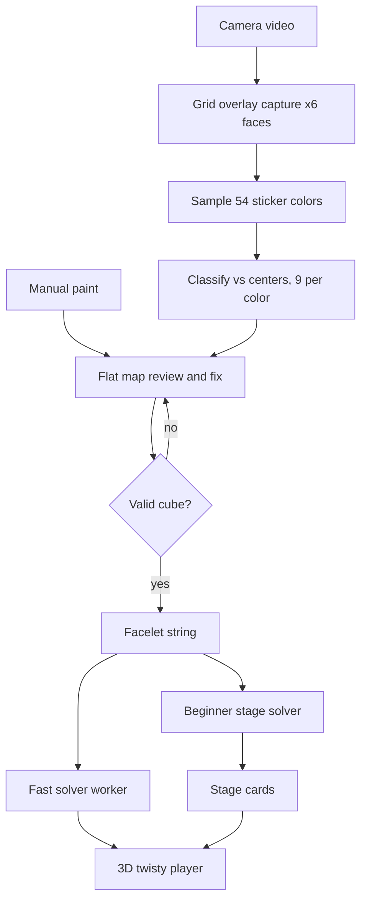
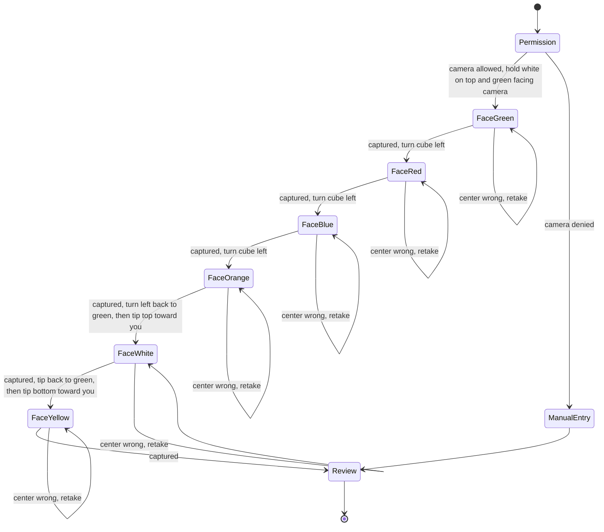

# Cube Scan, Solve and Trainer - Plan

## Goal Capsule

- **Objective:** A child can point any phone browser at a scrambled 3x3 Rubik's cube, get it read in about two minutes, and either follow a short solution or learn the beginner method stage by stage on their own real cube.
- **Means:** A static, client-only web app (KTD1) with a guided camera scan (KTD2, KTD3), a fast Kociemba solver (KTD4), and a beginner-method stage solver for teaching (KTD5).
- **Authority:** Product Contract Requirements win on behavior. KTDs win on mechanism. Units cite, never override.
- **Execution profile:** Greenfield repo, one PR. Built and checked by `ce-work`; the owner (a parent) reviews and pushes.
- **Stop conditions:** Stop and ask if the chosen solver libraries cannot run in iOS Safari, or if camera scanning cannot reach R6's accuracy bar after the U4 tuning pass. Do not add a server to work around either.

---

## Product Contract

### Summary

Build one mobile-first web page, hosted free as static files. It scans the cube with the phone camera, lets the child fix any wrong color, then offers two paths: "Solve it" shows a short move list on an animated 3D cube, and "Learn it" walks through the beginner layer-by-layer method using the child's own cube state. Everything runs in the browser; no photos leave the phone.

### Problem Frame

The owner's son has a Rubik's cube and wants to solve it. Store apps that scan cubes exist, but most are iPhone-only or Android-only, many push in-app purchases, and few teach a method; they just print moves. Free web tools exist too (the Ruwix scanner), but they cannot be shaped into a trainer for one child. The owner wants something that works on whatever phone is at hand, that teaches rather than only solves, and that costs nothing and needs no care to keep running.

### Requirements

**Scanning**
- R1. The app opens in iOS Safari and Android Chrome from a link, with no install, and asks for camera access only when the child starts a scan.
- R2. A guided scan captures all six faces, one at a time, with on-screen instructions that tell the child which face to show and how to turn the cube next.
- R3. After scanning, the child sees a flat map of all 54 stickers and can tap any sticker to change its color.
- R4. The child can also fill in the colors by hand with no camera, using the same flat map.
- R5. The app rejects an impossible cube with a plain-language message and points to the likely wrong stickers.
- R6. In normal indoor light, a scan of a standard-color cube needs no more than three manual fixes in typical use.

**Solving**
- R7. "Solve it" produces a solution of about 20 moves or fewer for any valid cube.
- R8. The solution plays on a 3D cube that starts from the scanned state, one move at a time, with forward, back, and play controls and the move name shown in kid-friendly words as well as notation.

**Learning**
- R9. "Learn it" splits the solve into the seven beginner-method stages, in order: white cross, white corners, middle layer, yellow cross, yellow edges, yellow corner placement, yellow corner twist.
- R10. Each stage shows its goal in one sentence, highlights the pieces that matter, and gives the moves for this child's cube for that stage only, one move at a time with a "Next move" button.
- R11. The app remembers which stages the child has finished on this device.

**Running and hosting**
- R12. The app is static files only; deploying a change is a git push, and hosting is free.
- R13. After the first visit the app works offline and can be added to the home screen.
- R14. Camera images are processed on the device and never uploaded.

### Key Decisions

- **Learn mode gives the moves one at a time, rather than asking the child to try the recipe first.** Easier for a beginner to follow. Governs R10. (session-settled: user-directed — chosen over try-first-then-show: owner preferred the simpler step-by-step flow.)

### Success Criteria

- From opening the link to seeing the first solution move takes under two minutes for a first-time child user, including any color fixes.
- Every "Solve it" and every "Learn it" sequence, applied to the scanned state, ends in a solved cube (checked by test over many random cubes, not by eye).
- The owner can ship a text change by editing one file and pushing, with no other step.

### Scope Boundaries

- Standard 3x3 cube with the standard color scheme only (white opposite yellow, green opposite blue, red opposite orange).
- One child, one device; no accounts, login, sync, or leaderboards.
- No app-store app and no native wrapper.
- Considered and not built: an AI vision service to read colors from a photo. It needs a server to hold an API key, which breaks R12, and the tap-to-fix map (R3) covers misreads cheaply. Revisit if R6 cannot be met in testing.
- Considered and not built: live AR arrows drawn on the real cube. Tracking a turning cube in the browser is fragile and costly; the 3D player (R8) gives the same guidance.

#### Deferred to Follow-Up Work

- Smart cube support over Bluetooth (GAN, GoCube, MoYu) via `smartcube-web-bluetooth`. It only works in Chrome on Android and desktop, not on iPhone.
- A scramble-and-timer practice mode with personal bests.
- Faster methods after beginner (CFOP lessons).
- 2x2 support.

---

## Planning Contract

### Key Technical Decisions

- KTD1. **Static site with Vite and TypeScript, no UI framework, deployed to GitHub Pages by a GitHub Actions workflow.** Five screens do not need React; plain TypeScript modules keep the dependency list short, which is what keeps maintenance low. GitHub Pages gives free HTTPS, which the camera API requires. Cloudflare Pages is an equal swap if the owner prefers it.
- KTD2. **Guided live-camera scan with a 3x3 grid overlay, not a single photo.** One photo sees at most three faces, so six guided captures are required anyway. The grid tells the child where to place the face, which makes sticker positions known without corner detection. Each sticker's color is the median of the inner part of its grid cell, which ignores the black plastic edges and glare spots.
- KTD3. **Classify colors against this cube's own six centers in CIELAB space, with a nine-per-color rule.** Centers never move, so each face's center is the reference color for that face, captured under the same light. CIELAB distance tracks how people see color better than raw RGB and cuts lighting effects. Forcing exactly nine stickers per color fixes most red/orange mix-ups, the main failure in camera cube scanners. Stickers that barely won their color get a visible "check me" mark on the map.
- KTD4. **Fast solve with `cubejs` (Kociemba two-phase, MIT) in a Web Worker; 3D playback with `cubing.js` `<twisty-player>` (MPL).** `cubejs` solves any state in 22 moves or fewer; its one-time table build takes a few seconds, so it runs in a worker started at app load so the page never freezes. `twisty-player` renders the cube from a setup sequence plus a solution, with built-in step controls and piece highlighting. If `cubejs` fails in iOS Safari, `torjusti/cube-solver` is the fallback.
- KTD5. **Teach with a home-built beginner-method stage solver, not with the Kociemba solution.** Kociemba output is short but cannot be explained to a child. The stage solver reaches each R9 stage goal in turn using the standard beginner algorithms (for example `R U R' U'` for corners) plus a small depth-limited search for the cross and for placing pieces before an algorithm. Its moves are longer (about 100 to 150) but every chunk maps to a named stage the child can understand. The beginner method changes how the cube is held (white cross on top, then white flipped to the bottom for every later stage), so the stage solver emits whole-cube turns (x, y, z) as their own "Flip your cube over" or "Turn the whole cube" sub-steps.
- KTD6. **One internal cube format: the 54-character facelet string in Kociemba face order (U, R, F, D, L, B).** `cubejs` reads it directly, and it converts to a move sequence for `twisty-player`. Every module passes this string, so there is one owner of "what the cube looks like". The frame is fixed: U is the white center and F is the green center. The scan hold table (U3), the 3D player, and the move words all use this frame, so "R" always means the side on the child's right while white is on top and green faces them.
- KTD7. **Offline and home-screen support through a web app manifest and a service worker generated at build time (`vite-plugin-pwa`).** It caches the app and solver files so the app works with no signal after the first visit (R13).

- KTD8. **Visual design: "Cube plastic" (Option A).** Dark cube-plastic ground (#1C1D22, panels #2A2C33), the six sticker colors as the only bright colors, yellow (#FFD500) primary buttons with dark text, Lexend type, large rounded touch targets (44 px or more). Every sticker shows its color letter. Mockups: https://claude.ai/artifact/MBNPgpGtk2JApyHbGRVSi7 (the Option A row). (session-settled: user-directed — chosen over Option B "Coach's notebook" light graph-paper style: owner preferred it.)

### High-Level Technical Design

Data flow from camera to answer. Everything in this diagram runs on the phone.



Scan sequence the child follows. The expected next-face center is shown on screen, so a wrong turn is caught at once, not at the end.



### Output Structure

```text
index.html
package.json
vite.config.ts
.github/workflows/deploy.yml
public/icons/
src/main.ts
src/app/router.ts
src/app/storage.ts
src/cube/facelets.ts
src/cube/validate.ts
src/scan/camera.ts
src/scan/scan-flow.ts
src/scan/sample.ts
src/scan/classify.ts
src/review/net-editor.ts
src/solve/solver.worker.ts
src/solve/fast-solve.ts
src/learn/beginner-solver.ts
src/learn/stages.ts
src/learn/learn-screen.ts
src/ui/player.ts
src/ui/move-words.ts
src/styles.css
tests/
```

---

## Implementation Units

### U1. App shell, hosting, and offline support

- **Goal:** A deployed, installable, empty app with a home screen and simple screen switching.
- **Requirements:** R1, R12, R13; KTD1, KTD7.
- **Dependencies:** none.
- **Files:** `package.json`, `vite.config.ts`, `index.html`, `src/main.ts`, `src/app/router.ts`, `src/app/storage.ts`, `src/styles.css`, `public/icons/`, `.github/workflows/deploy.yml`, `README.md`, `tests/smoke.spec.ts`.
- **Approach:**
  1. Vite + TypeScript project with Vitest for unit tests and Playwright for one browser smoke test.
  2. Hash-based router with screens: Home, Scan, Review, Solve, Learn.
  3. `storage.ts` wraps `localStorage` in try/catch so private browsing never breaks the app.
  4. Workflow builds on push to `main` and publishes to GitHub Pages; Vite `base` set to the repo path.
  5. README states the three owner tasks: run locally, change text, push to deploy.
- **Execution note:** Mostly setup; prove it with a deploy and a load on a real phone rather than unit tests.
- **Test scenarios:**
  - Smoke: loading the built site shows the Home screen with "Scan my cube" and "Enter colors by hand" buttons.
  - Smoke: navigating to `#/learn` and back works with the browser back button.
  - Edge: with `localStorage` throwing, the app still loads.
- **Verification:** The Pages URL opens on an iPhone and an Android phone, can be added to the home screen, and loads in airplane mode after one visit.

### U2. Cube state model and validity check

- **Goal:** One trusted representation of a cube and a check that rejects impossible cubes with a useful reason.
- **Requirements:** R5; KTD6.
- **Dependencies:** U1.
- **Files:** `src/cube/facelets.ts`, `src/cube/validate.ts`, `tests/cube/facelets.test.ts`, `tests/cube/validate.test.ts`.
- **Approach:** Facelet string helpers (from a face-by-face color grid, to a string, apply a move sequence including whole-cube turns x, y, z, is-solved). Validation checks, in this order so the message is most useful: nine of each color, six distinct centers, every edge and corner is a real piece, corner twist sum, edge flip sum, permutation parity. Each failure returns a kid-level message and the sticker indices to highlight.
- **Test scenarios:**
  - Happy: the solved string is valid; applying a scramble then its inverse returns the solved string.
  - Error: ten white stickers returns "too many white" and highlights white stickers.
  - Error: a single twisted corner returns the twist message and highlights that corner's three stickers.
  - Error: two swapped edge stickers (a flipped edge) returns the flip message.
  - Error: two swapped corners only returns the parity message.
  - Edge: a cube built from 1,000 random scrambles is always valid.
- **Verification:** All checks pass; every message has been read aloud and is understandable by a child.

### U3. Guided camera scan

- **Goal:** The child captures all six faces in a fixed, guided order and the app gets 54 raw color samples.
- **Requirements:** R1, R2, R14; KTD2.
- **Dependencies:** U1.
- **Files:** `src/scan/camera.ts`, `src/scan/scan-flow.ts`, `src/scan/sample.ts`, `tests/scan/sample.test.ts`, `tests/scan/scan-flow.test.ts`, `tests/scan/scan.e2e.spec.ts`.
- **Approach:**
  1. Back camera via `getUserMedia`, with the video set to inline and muted so iOS Safari plays it in-page. Request camera only on the Scan screen.
  2. Square overlay with a 3x3 grid; each step shows a cube picture with the face to show, the color that must be at the top edge of the image, and an arrow for how to turn next (state diagram above).
  3. Fixed hold table (KTD6 frame): start with white on top and green facing the camera. Green, red, blue, and orange are captured with white at the top edge of the image. White is captured by tipping the top toward you from the green view, so green is at the bottom edge. Yellow is captured by tipping the bottom toward you from the green view, so green is at the top edge. `scan-flow.ts` holds one 9-cell-to-facelet-index map per step, built from this table.
  4. Capture draws the current frame to a canvas; `sample.ts` takes the median color of the inner 50% of each cell.
  5. After each capture, check the center sample is near the expected center color; if not, name the expected face ("Show the red-center side") and retake.
  6. A live preview tints each grid cell with its sampled color so the child sees what the app sees before tapping capture.
  7. Camera denied or missing routes to manual entry (R4) with a short note.
- **Test scenarios:**
  - Happy: sampling a synthetic 300x300 image of nine solid colors returns those nine colors.
  - Edge: a cell with a white glare spot and black borders still returns the sticker's color.
  - Happy: scan flow moves green, red, blue, orange, white, yellow in order and ends on Review.
  - Error: a capture whose center does not match the expected face stays on that step and names the expected face.
  - Happy: six synthetic face images captured with the hold table's orientations produce the correct 54-character facelet string for a known scramble.
  - Integration (Playwright, Chromium fake camera fed a recorded cube video): a full scan reaches Review with 54 samples.
- **Verification:** On a real iPhone and Android phone, a full scan takes under a minute and no network request carries image data.

### U4. Color classification and review map

- **Goal:** Turn 54 samples into a color for each sticker, let the child fix mistakes, and support fully manual entry.
- **Requirements:** R3, R4, R5, R6; KTD3.
- **Dependencies:** U2, U3.
- **Files:** `src/scan/classify.ts`, `src/review/net-editor.ts`, `tests/scan/classify.test.ts`, `tests/review/net-editor.test.ts`, `tests/fixtures/scans/`.
- **Approach:**
  1. Convert samples to CIELAB; the six center samples are the references.
  2. Assign every sticker to a center color with each color capped at nine, filling the most confident matches first.
  3. Flag stickers whose best and second-best distances are close as "check me".
  4. The review map is the standard cross-shaped net. Tapping a side zooms it to a large 3x3; tapping a sticker there opens a six-color picker. Centers are locked. Every sticker and picker swatch shows its color letter (W, Y, R, O, G, B), and the "check me" mark is a dashed ring, so color is never the only cue (KTD8).
  5. The Review screen has two buttons, "Solve it" (to the Solve screen) and "Learn it" (to the Learn screen). Both stay disabled until U2 validation passes; validation errors highlight stickers on the map.
  6. Manual entry opens the same map pre-filled with centers only.
- **Execution note:** Collect a small fixture set of real scans (room light, lamp light, window light, at least two cube brands) before tuning; tune against those fixtures, not by eye.
- **Test scenarios:**
  - Happy: a fixture scan in room light classifies with zero errors.
  - Edge: red and orange samples that sit close in color still split nine and nine.
  - Edge: a warm lamp fixture classifies with three or fewer errors (R6).
  - Happy: tapping a sticker and choosing blue updates the map and re-runs validation.
  - Error: an invalid map keeps both "Solve it" and "Learn it" disabled and shows the U2 message.
  - Happy: manual entry with all 48 stickers painted and valid enables both buttons.
- **Verification:** Across the fixture set, the average number of fixes needed is three or fewer.

### U5. Fast solve with 3D player

- **Goal:** "Solve it" shows a short solution on an animated 3D cube that matches the child's cube.
- **Requirements:** R7, R8; KTD4, KTD6.
- **Dependencies:** U2, U4.
- **Files:** `src/solve/solver.worker.ts`, `src/solve/fast-solve.ts`, `src/ui/player.ts`, `src/ui/move-words.ts`, `tests/solve/fast-solve.test.ts`, `tests/ui/move-words.test.ts`.
- **Approach:**
  1. Start the worker at app load so the solver tables build while the child scans.
  2. Send the facelet string; receive the move list.
  3. `player.ts` wraps `<twisty-player>`, setting the setup to the inverse of the solution so the 3D cube starts at the scanned state, shown in the KTD6 frame. Before move 1, a "Hold your cube with white on top and green facing you" picture appears.
  4. Big buttons for back, next, and play; a counter "Move 4 of 19".
  5. `move-words.ts` turns notation into words: `R` becomes "Right side, turn away from you", `U'` becomes "Top, turn to the right".
- **Test scenarios:**
  - Happy: for 1,000 random valid cubes, applying the solution gives the solved cube and the length is 22 or fewer.
  - Edge: an already-solved cube returns an empty solution and a "Already solved!" message.
  - Happy: every one of the 18 face moves and the whole-cube turns (x, y, z and their primes and doubles) has a word description.
  - Integration: the player's starting state equals the scanned facelet string.
- **Verification:** On a phone, solving a real scrambled cube by following the player works start to finish.

### U6. Beginner-method stage solver

- **Goal:** For any valid cube, produce seven ordered stage chunks of moves that follow the beginner method.
- **Requirements:** R9, R10; KTD5, KTD6.
- **Dependencies:** U2.
- **Files:** `src/learn/beginner-solver.ts`, `src/learn/stages.ts`, `tests/learn/beginner-solver.test.ts`.
- **Approach:**
  1. `stages.ts` owns, per stage: a goal check on the facelet string, the beginner algorithms, and the child-facing text.
  2. White cross: small depth-limited search per edge, solving edges one at a time, so each edge is its own teachable chunk.
  3. White corners, middle layer: bring the piece above its slot with top-layer turns, then apply the matching beginner algorithm.
  4. Yellow stages: recognize the case (dot, line, L, cross; then edge, corner placement, corner twist) and apply the standard beginner algorithm, repeating as the method says.
  5. Return each stage with its moves split into sub-steps the child can follow, each with a short note ("Bring the white-red edge to the top").
- **Execution note:** Implement test-first; the per-stage goal checks are the test oracle.
- **Test scenarios:**
  - Happy: for 1,000 random cubes, after each stage's moves that stage's goal check and all earlier ones are true, and the final cube is solved.
  - Edge: a cube whose white cross is already done returns an empty cross stage with "Already done, nice!".
  - Edge: each yellow-cross case (dot, line, L) is recognized from a fixed fixture.
  - Edge: the corner-twist stage handles the case where only two corners need twisting.
  - Happy: total length stays under 200 moves for all 1,000 cubes.
- **Verification:** All 1,000-cube runs pass and no stage ever loops without progress.

### U7. Learn mode screen

- **Goal:** The child works through the seven stages on their own cube with clear goals, highlights, and saved progress.
- **Requirements:** R9, R10, R11, R8; KTD4, KTD5.
- **Dependencies:** U5, U6.
- **Files:** `src/learn/learn-screen.ts`, `tests/learn/learn-screen.test.ts`.
- **Approach:**
  1. Stage list with a progress bar; each stage card shows the one-sentence goal and a picture of the finished stage.
  2. A stage screen shows, top to bottom: the goal sentence and a "hold your cube like this" picture, the shared player, then the current sub-step note with its move words and Back / Next buttons that step one sub-step at a time. The player highlights the pieces in play (cubing.js stickering) and dims the rest. "I did it!" appears after the last sub-step.
  3. "I did it!" opens the next stage, starting the player from the end state of the previous stage.
  4. Progress belongs to the current cube: `storage.ts` keeps the last scanned facelet string and the current stage and sub-step. On reopening, the stage list marks a stage done when its U6 goal check passes on the cube state reached so far.
  5. A "Rescan" button is always there, for when the real cube and the screen drift apart. After a rescan from Learn, run the U6 goal checks on the new cube, mark the passing stages done, and reopen at the first failing stage with moves recomputed from the new state.
- **Test scenarios:**
  - Happy: finishing stage 1 and reloading the page reopens at stage 2 of the same cube.
  - Happy: stage 3 starts from the state after stages 1 and 2.
  - Happy: Back and Next step through one stage's sub-steps, and "I did it!" shows only after the last one.
  - Happy: rescanning a cube whose white cross is done but corners are not reopens Learn at stage 2.
  - Happy: a fresh scan of a new scramble replaces the saved cube and its progress.
  - Edge: storage unavailable means progress is not kept but the screen works.
  - Happy: "Rescan" returns to the Scan screen.
- **Verification:** A child who has not solved a cube before reaches a solved cube using only Learn mode, with an adult nearby only for reading help.

---

## Verification Contract

| Gate | What it proves | When |
|---|---|---|
| `npm run test` (Vitest) | State model, validation, sampling, classification, both solvers | Every change |
| `npm run e2e` (Playwright, Chromium with fake camera video) | Home loads, full scan reaches Review, solve renders | Every change |
| `npm run build` | Static bundle and service worker build | Every change, and in the deploy workflow |
| Manual phone check | Camera, 3D player, offline, add-to-home-screen on iOS Safari and Android Chrome | Before calling U3, U5, U7 done |

---

## Definition of Done

- All requirements R1 to R14 are met and shown on a real iPhone and a real Android phone.
- All test gates above pass; the 1,000-cube solver tests in U5 and U6 pass.
- The app is live on GitHub Pages from the workflow, with no server and no paid service.
- The README tells the owner how to run, change, and deploy the app.
- No dead-end or experimental code from abandoned approaches is left in the diff.

---

## Risks and Dependencies

| Risk | Mitigation |
|---|---|
| Red and orange look alike under warm light | KTD3 centers-as-reference and nine-per-color rule; "check me" marks; tap-to-fix map (R3) |
| Child scans faces in the wrong order or orientation | Center check after each capture (U3 step 4); validation errors point at stickers (R5) |
| `cubing.js` experimental attributes change before its 1.0 | Pin the exact version; keep all `twisty-player` use inside `src/ui/player.ts` |
| iOS Safari camera quirks (inline video, HTTPS only) | Inline and muted video; HTTPS from Pages; manual entry fallback |
| Solver table build is slow on old phones | Run in a worker started at app load (KTD4); show a friendly "warming up" note if still building |
| Beginner solver bug leaves a stage unsolved | 1,000-cube test with per-stage goal checks (U6) |

---

## Sources and Research

**Libraries this plan uses**
- `cubejs` (ldez/cubejs, MIT): Kociemba two-phase solver, 22 moves or fewer, one-time init of about 4 to 5 seconds, Web Worker friendly. https://github.com/ldez/cubejs
- `cubing.js` `<twisty-player>` (MPL): 3D/2D cube player with setup sequence and stickering highlights; experimental attributes may change. https://js.cubing.net/cubing/twisty
- `vite-plugin-pwa`: manifest and service worker for offline use.

**Prior art to read while building**
- dejwi/rubiks-app: Next.js + three.js solver with camera scan; small project, useful as a reference for scanning UI. https://repos.ecosyste.ms/hosts/GitHub/repositories/dejwi%2Frubiks-app
- kkoomen/qbr: Python webcam scanner using CIEDE2000 color distance and a calibrate mode; source of the CIELAB approach in KTD3. https://github.com/kkoomen/qbr
- torjusti/cube-solver: JS solver collection (Kociemba and others), a fallback if `cubejs` gives trouble. https://github.com/torjusti/cube-solver
- poliva/smartcube-web-bluetooth and afedotov/gan-web-bluetooth: smart cube support for the deferred Bluetooth follow-up. https://github.com/poliva/smartcube-web-bluetooth

**Existing services the family can use today**
- Ruwix web scanner: free browser camera scan and solve, with manual fix. https://ruwix.com/cube-solver/scan/
- Store apps such as "3D Cube Solver - Solve & Play" (iPhone, free, offline). Most others carry in-app purchases.

