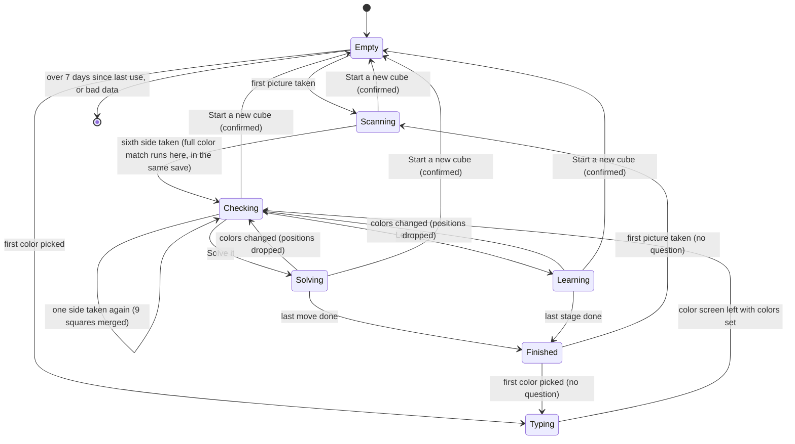
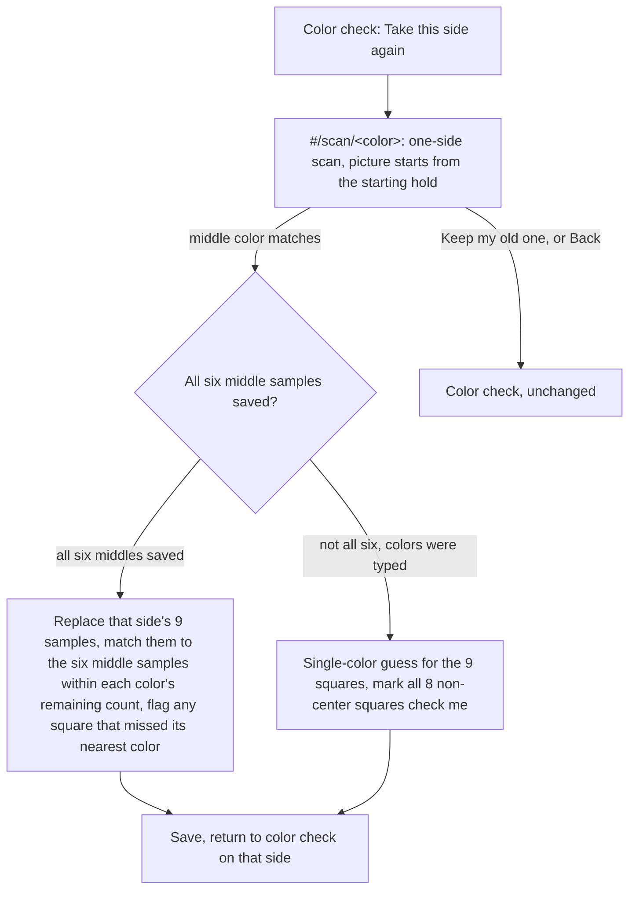
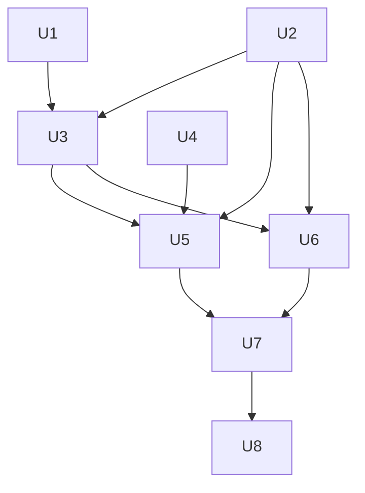

# Easy for Every Age - Plan

## Goal Capsule

- **Objective:** A child of 6 or a grandparent of 75 can scan, fix, solve, and learn their cube with no help from anyone. They never lose their work to a wrong tap, a refresh, or a closed app.
- **Means:** Save the work at every step and offer to continue it (KTD1, KTD2). Show each move as it becomes the current one (KTD4). Show how to turn the cube between sides with a moving picture, and let any side be taken again on its own (KTD5, KTD6). Make every word and button bigger (KTD8). Make the app install and behave like a phone app (KTD9).
- **Authority:** Product Contract Requirements win on behavior. KTDs win on mechanism. Units cite them and never override them. The earlier plan `docs/plans/2026-11-22-1142-feat-cube-scan-solve-trainer-plan.md` still governs everything this plan does not change.
- **Execution profile:** One PR from a feature branch off `main`. `ce-work` builds and checks it. The owner (a parent) reviews it, tries it on a real phone, and merges. A merge to `main` deploys to GitHub Pages.
- **Stop conditions:** Stop and ask if the saved session would need a server or an account. Do not change the dark theme (earlier plan, KTD8) without the owner's approval.

---

## Product Contract

### Summary

Every step now saves itself on the phone for up to 7 days. Home offers "Keep going" when work exists. The scan shows a small moving cube that turns the way the real cube must turn before each picture. Any side can be taken again during the scan or from the color check screen, and the other sides keep their fixes. Solve and Learn show each move moving at the moment the child must do it, with a "Show again" button. Actions that would throw away saved work ask first, with big, clear buttons. Text and buttons get bigger everywhere, and the app installs to the home screen with proper icons and a short helper.

### Problem Frame

The owner tried the app and hit five problems in one session. During the scan it was not clear which way to turn the cube for the next side. A side with wrong colors could not be scanned again, so the only fix was to start the whole scan over. After fixing a side on the color check screen and tapping "Solve it", the first move looked skipped. Then a tap on a "refresh" button, meant to be "back", dropped the owner on the first page with all the work gone.

That refresh button is most likely the app's own "Scan again" button. It sits in the top corner of Solve, Learn, and the color check, it has no words, and its icon is two round arrows, the same picture browsers use for refresh (`rescan` in `src/ui/dom.ts`). One tap opens the scan at side 1, and Back from there goes Home, where nothing offers the old work. The browser's own refresh loses work too, on the scan and the color check. This plan fixes both.

The app's audience is children who are learning, and the owner also wants it to work for older people. Both groups read slowly, miss small targets, and are easily lost by a screen that changes without saying why. Research backs this up. Primary buttons need about 1 cm of height for adults and 2 cm for children under 9. Instruction text needs to be large and high in contrast. Steps must never move on by themselves (NN/g on seniors and children, WCAG 2.2).

Today only the checked cube and the Learn position survive a refresh. Scan progress, camera colors, and color fixes live only in memory. On phones, "are you sure?" prompts before a refresh are mostly ignored (MDN: `beforeunload` is not reliable on mobile), so a warning alone cannot protect the work.

### Requirements

**Solving and learning steps**
- R1. On Solve and Learn, the move shown on the card is the move that plays on the 3D cube at that moment, including the first move.
- R2. A "Show again" button replays the current move as often as the child wants.
- R3. Next and Back cannot be used until the moves are known. A tap can never skip a move without showing it. If the 3D cube cannot load, Learn still works with the move cards alone.

**Saving and coming back**
- R4. The app saves the work after each step: each side scanned, each color fixed, each move on Solve, and each move on Learn. A refresh, a closed tab, or a reopened app returns to the same work.
- R5. Saved work is kept on this device for up to 7 days after it was last used, then it is thrown away. Nothing leaves the phone. Work already saved by the earlier version of the app (the checked cube and the Learn position) carries over once.
- R6. When unfinished saved work exists, Home shows "Welcome back" with "Keep going" as the big button and "Start a new cube" as the small one. "Start a new cube" takes the place of "Scan my cube", so Home never shows two buttons that start a scan. A cube that is already solved is finished work, and Home does not offer it.
- R7. When "Keep going" continues Solve or Learn, the app first shows the 3D cube as it was before the current move and asks "Does your cube look like this?" "Yes, keep going" continues on that move. On "No, it looks different", the app plays the current move and asks once more, because the child may have done that move before leaving. "Yes, keep going" then continues on the next move, and "No, scan it again" goes to the scan. A refresh that reopens the same screen asks nothing and shows the same move.
- R8. A change to the colors starts Solve and Learn over for the new cube. A saved position never plays moves meant for a different cube.

**Leaving safely**
- R9. An action that would throw away saved work asks first. These actions are starting a full new scan, typing colors from the start, and "Start a new cube". The question names what will be lost. The big button keeps the work, and the button that deletes says so in words.
- R10. The app asks only when real work would be lost. Opening the scan or the color screen and leaving again without doing anything never asks and never deletes. Finished work (a solved cube) is not real work, so replacing it never asks.
- R11. In-app Back buttons never delete work. On the scan screen opened for one side, Back returns to the color check with nothing changed. On the full scan screen, Back returns to the screen the child came from, so a wrong tap on "Scan again" costs one tap to undo.

**Scanning**
- R12. Before each side, a small moving cube shows how to turn the whole cube to get there, and the words say the same thing. It plays once. A "Show me again" button replays it. With reduced motion turned on, a still picture with an arrow is shown instead.
- R13. When a side is not the next one in order (a side taken again, or a scan continued later), the picture and words start from "white on top, green facing you".
- R14. During the scan, the six side markers are big buttons. Tapping a side already taken lets the child take it again. The scan then returns to the side the child was on.
- R15. On the color check screen, "Take this side again" scans only the selected side, then returns to the color check. The new side replaces only those 9 squares, and the fixes on all other sides stay.
- R16. Taking a side again never silently replaces a good side with the wrong side. "Keep my old one" is on screen from the start of every retake, during the scan and from the color check, so a wrong tap on a side marker is undone in one tap. "Use it anyway" is never offered for a retake.

**Easy to see and tap**
- R17. No text is smaller than 16 px. Instructions are at least 20 px. Main buttons are at least 64 px tall. "Take picture" is at least 80 px tall. Every other control is at least 48 px, with at least 8 px between controls. The page can still be zoomed. On a 360 x 640 screen, the main picture (camera or 3D cube), the instruction, and the main button are all visible with no scrolling.
- R18. Every button shows words, not only an icon. "Scan again" shows the camera icon and its words, not the two round arrows that look like refresh. Button edges, empty progress marks, and sticker outlines have at least 3:1 contrast with the background.
- R19. The color squares in the close-up card on the color check screen show their letter at a readable size. The small map is a picture and carries no letters. Instruction text changes are announced to screen readers.

**App experience**
- R20. Home shows a short "Add to your home screen" helper until the app is installed or the helper is dismissed. On Android it is a button that opens the install prompt. On iPhone it shows the Share, then "Add to Home Screen" steps. It appears before the first scan.
- R21. The installed app has sharp icons on Android and iPhone and opens full screen with a matching status bar.
- R22. The screen stays on while Solve or Learn is open.

### Key Decisions

- **Seven days counts from the last use, not from the first save.** A learner who comes back every few days never loses their place. A cube left alone for a week has almost surely changed on the table. Governs R5.
- **The earlier plan's "remembers finished stages on this device" (its R11) is narrowed.** Learn progress now lives inside the saved work and follows its 7-day rule. Governs R5, R8.
- **A full new scan is a deliberate fresh start. Taking one side again is the fix for a bad side.** Governs R9, R14, R15.
- **Recommended extras are listed, not built.** Read-aloud and the others under Deferred to Follow-Up Work wait for the owner's choice.

### Success Criteria

- A child aged 6 to 8 and an adult over 65 each finish scan, fix one side, solve, close the app, reopen, and continue, on a real phone, with no help and no lost work.
- On a 390 px wide phone screen, no tap target on Home, Scan, Color check, Solve, or Learn is under 48 px, and no text is under 16 px.
- The owner's five reported problems no longer happen: the unclear turn, the full restart to fix one side, the skipped first move, the work lost on refresh, and no protection when leaving.

### Scope Boundaries

- No server, no accounts, no syncing between devices. Saved work stays on one phone and in one browser.
- No native app store app. The installed web app is the app experience.
- No automatic picture taking. The child still taps "Take picture".
- No change to the dark theme or the solving methods.
- The Practice screen keeps today's behavior and is not saved.

**Considered and not built**
- `beforeunload` "Leave site?" prompts are not built. Every step is saved already, so a prompt has nothing to protect. iOS mostly ignores it, and it can stop the browser from restoring the page quickly. Revisit only if testing shows work lost between saves.
- History traps (extra history entries that swallow Back) and cancelling Back with the Navigation API are not built. Chrome skips such entries, they confuse users, and Back is harmless once work is saved.
- Two open tabs writing the same saved work is not handled. The last write wins. This is rare on a phone and costs at most one session. Revisit if the owner reports it.
- `navigator.storage.persist()` is not called. Safari clears storage under pressure only rarely, and the call is one line to add later. Revisit if saved work disappears inside 7 days on a real phone.
- A second save when the app is hidden is not built. Every step saves at once, so nothing is left to write when the app goes to the background. Revisit only if a later change delays the step saves.

#### Deferred to Follow-Up Work

These are the recommended extras for the owner to choose from.
- Read-aloud of each instruction (a speaker button using the phone's built-in voice). This is the biggest help for children who cannot read yet and for people with low vision.
- A short celebration when a stage or the whole cube is done, with a still badge when reduced motion is on.
- Haptic tap feedback on Android.
- A larger-text switch, for users who want more than the new default sizes.
- Automatic picture taking when the cube is steady in the frame.
- Saving the Practice cube.

### Open Questions

These do not block the work. Each is checked on a real phone before merge.
- Does an iPhone keep a Safari tab's saved work separate from the installed app's? Research says yes but could not confirm it from Apple's own sources. The helper is placed before the scan either way (R20).
- Does a swipe from the left edge in the installed iPhone app act as Back? It is harmless either way because of R4, but the owner should know.
- Does a retake from the color check, which restarts the camera, show the camera permission prompt again in the installed iPhone app? Research says the prompt comes back per cold start, not per restart. If it appears on every retake, tell the owner before merge (KTD5).
- Which screen did the owner see the "skipped" first move on? Both possible causes are fixed (U1), so the answer only matters as a check that the problem is gone.
- Which "refresh" button did the owner tap: the app's two-arrow "Scan again" button, or the browser's? Both are fixed (R4, R11, R18), so the answer only confirms the fix.
- Does move 1 turn on screen the first time Solve opens on a slow phone, or does the 3D view finish loading after the turn has played? U1 waits for the view, and "Show again" covers a miss. If the turn is still missed, add a short pause before the first play.

---

## Planning Contract

### Key Technical Decisions

- KTD1. **Saving every step is the protection. Leave prompts are not.** Every state change writes to `localStorage` at once, so no later save is needed when the app is hidden or closed. Research shows `beforeunload` and `pagehide` are unreliable on mobile, and pull-to-refresh on iOS cannot be blocked (MDN, Chrome Page Lifecycle, WebKit bug 275947). In-app confirms (KTD7) cover only actions the child chooses.
- KTD2. **One versioned saved-session record replaces the two loose keys.** It is a single `localStorage` entry with a version number and a `savedAt` time, written through the existing `src/app/storage.ts` wrapper so private mode keeps working. It holds:
  - the route
  - the camera samples: always 54 slots, with an empty slot for each square not yet taken (which sides are taken is worked out from them, KTD5)
  - the colors, the "check me" flags, and the "filled in for you" marks
  - the checked cube
  - the Solve position
  - the Learn position

  The saved route is used only by "Keep going" on Home. A browser refresh keeps the URL, so the router opens the same screen again, and that screen reads its step from the saved session. No screen is redirected by the saved route.

  Colors may differ from the checked cube while the child is still fixing them. Positions belong to the checked cube (KTD3). Saved data is a trust boundary, so loading runs two checks:
  - **Shape check. On failure, the whole record is thrown away.** It fails for an unknown version, JSON that does not parse, a `savedAt` that is not a finite number or is more than a day in the future, or an age over 7 days (R5). It also fails when a field has the wrong shape:
    - colors: 54 entries, each a color letter or empty, with each middle matching its side
    - flags and "filled in for you" marks: square numbers 0 to 53
    - samples: each side either 9 triples of whole numbers from 0 to 255 or all empty
    - positions: whole numbers

    Half-finished colors pass, such as typed colors with gaps, or 10 of one color during fixing.
  - **Solver gate. On failure, only the cube and positions are dropped.** The checked cube must pass `src/cube/validate.ts` before it reaches the solver. If it fails, the checked cube and both positions are dropped, colors and samples stay, and the route becomes the color check. Saved Solve moves get their own check (KTD3), because wrong moves would make the child scramble the real cube.

  Rejected: checking and salvaging each field on its own. The app writes this record itself, so a bad field means a bug or a dropped version, which is rare. Discarding the whole record costs one session.

  The age is checked on load and again whenever the app becomes visible, because an installed app can come back from the background after days. If that check expires the record while a work screen is open, the app goes to Home. Every save stamps a new `savedAt`. A save happens at a step (a picture, a pick, or a move) and when a screen that continues the saved work opens (the color check, Solve, or Learn) and records its route. The scan and the typed-color screen record their route only with their first saved step, because opening them must not touch saved work (KTD7). Putting the app in the background and bringing it back writes nothing, so it does not restart the 7 days.

  Loading is one exported function in `src/app/session.ts`. The module calls it once at start, and the tests and the visible check call it again.

  The old `cube.facelets` and `learn.progress` keys migrate once:
  1. An old cube that fails `validate` is not migrated, and both old keys are removed.
  2. Otherwise the new record is written. `save` in `src/app/storage.ts` reports whether the write worked.
  3. Only after a successful write are the old keys removed. If the write fails, the old keys stay, and the next load tries again.

  Migrated work gets the current time as `savedAt`. "Clear all" and expiry remove the session and both old keys, never all of `localStorage`. Rejected: clearing the old keys on every load to guard against a tab still running the old code. The plan already accepts that two tabs can overwrite each other (Scope Boundaries). The version number changes only for a shape change that cannot be read forward.
- KTD3. **Solve and Learn positions carry the cube they belong to.** A position is the count of moves the child has finished with Next. It is 0 on the first move, and it equals the number of moves when the done card shows. This is the meaning `learn.progress` has today, so a migrated Learn position still points at the same move. Each position stores the cube string next to it, the same rule `learn.progress` uses today. A position whose cube differs from the current one is dropped (R8). Solve also stores its move list, so resuming does not wait for the cold solver and "move k" means the same move after a reload. The saved list is used only if applying it to the checked cube gives a solved cube and the position is a whole number from 0 to the list length. Otherwise the list is dropped and the solver runs again, because wrong moves would make the child scramble the real cube. The Learn stage is clamped to 0 to `STAGES.length`, and the move is clamped to that stage's moves. The beginner plan is worked out again on each load, and an app update can change it.
- KTD4. **The current move is the one that plays.** The 3D cube rests after the current move. Becoming current means playing that move from the state before it. Next makes the next move current. Back makes the previous move current and replays it. "Show again" replays the current move. This fixes the off-by-one where the card showed move k while the cube waited before it, and a move played only when the child tapped Next to leave it (`src/solve/solve-screen.ts`, `src/ui/player.ts` `next`/`render`). "Ready" means the move list is known, not that the 3D view has loaded. In Learn, the 3D cube needs a solver result (`base`), so Next and Back are blocked only until the step plans exist. If the solver fails, the cards keep working without the 3D cube (R3). `CubePlayer` already has a "show a state and play one move" path (`playMove`, used by Practice), so Solve and Learn build on it. Moves and Practice keep their current behavior. While a move is playing, Next, Back, and Show again are locked, so a fast double tap cannot hide a move (R3). The lock is a timer, the way Practice locks its buttons during "Do it for me" (`slowMoveMs` in `src/practice/practice-screen.ts`): the app does not listen to cubing.js for the end of a move. The time is the move's length at the current speed, about 1 second for a quarter turn and 1.5 seconds for a half turn at normal speed, divided by the tempo. The first move plays only after the 3D view is ready, so the turn is not over before the child can see the cube (Open Questions). Saved work is finished when the Solve position equals the number of moves, or the Learn stage is past the last stage (R6, R10).
- KTD5. **The scan tracks which sides are taken, and the turn picture is a CSS cube.** `ScanFlow` changes from a single counter to "which of the six sides are taken". A side is taken when all 9 of its samples are present. This is worked out from the samples, never stored as a second list that could disagree with them. The full color match runs in the scan screen at the moment the sixth side is taken, and the samples, colors, "check me" flags, and route are written in that one save. The color check screen never runs the full match, so no "has it run yet" flag is needed and a refresh cannot run it twice. The next side is the first one not yet taken, in the existing order. Opening the scan when the saved route is the scan continues that scan. A side is "in order" only when it comes right after the side just taken in this sitting. The first side after reopening a scan, and every side taken again, are out of order and start from the starting hold (R13). Each step keeps its `hold` (the whole-cube turn from the starting position, already in `HOLDS`) so the picture can animate from the previous hold, or from the starting hold for an out-of-order side (R13). Each step also carries two short lists of whole-cube turns: one from the previous step's hold and one from the starting hold. Examples: white after orange is "turn left" then "tip the top toward you", and yellow after white is "tip the bottom toward you" twice. The picture plays the turns in the list one at a time, each around its own axis, and the words name the same turns in the same order. One straight blend from the old pose to the new pose is not used, because the browser takes the shortest path and the cube tumbles sideways in a way the words do not describe. The picture is a small CSS 3D cube built like the spinning cube on Home and the mini cube in `src/ui/hold.ts`, animated with CSS transforms. It is not a second `TwistyPlayer`, because WebGL next to a live camera strains phones and phones allow only a few WebGL views. The existing reduced-motion rule in `src/styles.css` stops the animation, so the still state is the final pose plus one arrow for each turn in the list, in order: a left arrow, a right arrow, a "tip toward you" arrow from the top, or one from the bottom (R12). The camera stream stays open while the child moves between sides on the scan screen, because restarting it costs time and can bring back the permission prompt. A retake from the color check opens the scan route again, so the camera restarts there. Research found that installed iPhone apps ask again after each cold start of the app, not after each restart within one session. This is checked on a real phone (Open Questions).
- KTD6. **Taking a side again merges 9 squares and leaves the rest alone.** The camera samples are kept in the saved session instead of being thrown away after the first color match. The color check screen always starts from the saved colors. The full color match has already run in the scan screen (KTD5), which fixes today's rule that would wipe fixes on every visit. For a side taken again, the 9 new samples replace that side's samples. Its 9 colors are then matched against the six middle samples only. Each color is limited to 9 minus the squares of that color already on the other five sides in the current colors, which include the child's fixes. Any square that did not get its nearest color is marked "check me", and so is any close call, by the same margin rule `classify` uses. The side's old flags and "filled in for you" marks are cleared first. The other sides' colors and flags never change. Re-running the full 54-sample match was rejected. It counts the other sides' raw samples, not the child's fixes, so a fixed square elsewhere could push a correct square on the retaken side to the wrong color with no warning. When the six middle samples are not all saved, the side uses the existing single-color guess (`nearestColor` in `src/scan/sample.ts`), and all 8 non-center squares are marked "check me". This covers people who typed their colors, including on their second retake, when only one side has samples. Samples are cleared when typed colors replace a scan (at the confirmed first pick, KTD7), so stale samples never meet typed colors. A merge never goes to the solver directly. "Solve it" or "Learn it" checks the cube first, as today. The one-side scan is the route `#/scan/<color>`. The router already passes a param to `scanScreen`, which ignores it today. The one-side scan does not record itself as the saved route, so "Keep going" still opens the color check. It returns to `#/review/<color>`, and the color check opens on that side. A refresh during a one-side scan opens the same one-side scan again. If no colors are saved at that point, it goes Home.
- KTD7. **Old work is replaced at the first new data, and only then does the app ask.** Opening Scan or "Type in the colors" does not touch saved work. The first picture taken, or the first color picked, starts the new work. If saved work exists at that moment, a confirm dialog appears first (R9, R10). This needs no router guard on every navigation. The dialog is a native `<dialog>` opened with `showModal()`. It holds two big verb-labelled buttons, and the safe choice is the primary one. It is appended inside the screen root, so the router's screen change removes it. Until the child taps the delete button, the waiting picture or pick stays inside the screen only and is never written to the session. Closing the dialog any other way counts as "keep": Esc, the Android back gesture (the dialog's `cancel`), or a screen change. "Delete and start over" clears the old work and writes the new data in one single save. The full scan's Back button goes back in history to the screen the child came from, or Home when there is no history, the same rule U6 gives the Moves screen (R11). Three cases never ask:
  - Finished work (KTD4) is replaced with no question (R10). "Scan a new cube" on the "You solved it!" card must not warn a child who has just solved the cube.
  - Answering "No, scan it again" at the cube check (R7) already agrees to replace the work, so the first picture of that scan replaces it with no second dialog.
  - Typed mode (`#/review/manual`) whose saved work is itself typed work (colors, no samples, no checked cube) starts from the saved colors and does not ask. A refresh during typing keeps the typed colors (R4).
- KTD8. **Sizes become shared tokens.** Font sizes and control heights move from hard-coded px in each CSS file, and from inline styles in the screen code, to custom properties set once in `src/styles.css`. The values follow R17. Topbar icon buttons gain a visible word ("Back", "Scan again") to meet R18, and "Scan again" changes to the camera icon. Button names that tests find by text or aria-label keep their exact wording, or the tests change in the same unit. Bigger controls must still fit a small phone (R17), so these layout rules are part of the decision:
  - When a screen is too tall for 360 x 640, the camera box and the 3D cube box shrink first. The instruction and the main button never leave the screen. Links such as "Type in the colors instead" may sit below the fold.
  - The six side buttons on the scan get their own row under the top bar. Six 48 px buttons with 8 px gaps need 328 px, so the scan screen uses 16 px side padding.
  - The small map on the color check drops its letters. A map side is about 64 px wide, so a letter there cannot reach 16 px. The close-up card keeps the letters, and each map side keeps its spoken label.
  - Learn's move chips show the words for the current move only, on one line under the chips. Words at 16 px do not fit under every chip.
  - If Learn's top bar cannot hold "Back", the stage bar, "Moves", and "Scan again" with words at 360 px, the stage bar moves to its own row.
- KTD9. **Installing is configuration plus one small helper.**
  - PNG icons are made once from the existing SVG and committed: 192, 512, a separate maskable 512 with the cube inside the safe circle, and a 180 px opaque Apple icon. No image tool is added to the dependencies.
  - `index.html` gains the Apple web app meta tags and points `apple-touch-icon` at the PNG.
  - The install helper uses `beforeinstallprompt` on Android. The browser fires that event once, soon after load, and often before Home is on screen or while another screen is open. So the listener is added in `src/main.ts` at startup and keeps the event until Home needs it. On iPhone the helper shows the Share-sheet steps. It is hidden when the app runs standalone, and its "dismissed" flag is stored outside the saved session.
  - Wake lock is requested when Solve or Learn opens, requested again when the page becomes visible, and released in the screen cleanup. Every failure is ignored.
  - Home order, top to bottom, in one column: the Welcome back card when work exists (naming the step, for example "Learn, stage 3"), then the existing buttons, then the install helper as a smaller strip that can be dismissed. While the Welcome card shows, "Keep going" is the only primary button, and "Start a new cube" takes the place of "Scan my cube" (R6). With no saved work, or with finished work only, Home looks as it does today.

### High-Level Technical Design

The saved session moves through these states. Every screen reads it from `src/app/session.ts` and writes it back after each step.

Taking one side again on the color check screen:

Step model on Solve and Learn (KTD4). In this table, "move k" is the number on the card, counted from 1. While the card shows move k, the 3D cube rests after move k, and the saved position is k - 1 (KTD3).

| Action | Card shows | 3D cube does |
|---|---|---|
| Moves become known | Move 1 | Shows the start, then plays move 1 |
| Next on move k | Move k+1 | Plays move k+1 from the state after move k |
| Back on move k | Move k-1 | Jumps to before move k-1, then plays it |
| Show again | Move k (no change) | Jumps to before move k, then plays it |
| Next on the last move | Done card | Rests at the solved cube |
| Opened again at saved position p (refresh, or after the cube check) | Move p+1 | Shows the state after p moves, then plays move p+1 |
| Cube check from "Keep going" at position p (R7) | The question | Shows the state after p moves, with no move playing |
| Cube check, "No, it looks different" | The question again | Plays move p+1 and rests after it |

### Implementation Constraints

- Keep the earlier plan's rules: no framework, screens built with `h()` from `src/ui/dom.ts`, only `src/ui/player.ts` talks to cubing.js, and every word a child sees lives next to its screen.
- Every `localStorage` read and write stays inside the try/catch of `src/app/storage.ts`.
- Do not store camera images. Store only the sampled colors, about 54 numbers times 3.
- Keep button names that tests use, or update those tests in the same unit (KTD8).

### Sequencing

U1 comes first because resuming makes the cold-solver case common, and the skip bug lives there. U2 builds the saved session that U3, U5, and U6 write into. U4 and U5 both change the scan screen, so U4 lands first. U5 also needs U3, because U3 is the unit that stops the color check from throwing the camera samples away, and the retake compares against those samples. U7 and U8 have no flow dependencies and go last, so the new screens get the new sizes in one pass.

---

## Implementation Units

### U1. Show each move as it becomes the current one

- **Goal:** Solve and Learn play the move the card shows, can replay it, and never skip a move.
- **Requirements:** R1, R2, R3. KTD4.
- **Dependencies:** none.
- **Files:**
  - Modify: `src/ui/player.ts`, `src/solve/solve-screen.ts`, `src/learn/learn-screen.ts`, `src/styles.css` and `src/learn/learn.css` (Show again button)
  - Create: `tests/solve/solve-screen.test.ts`
  - Modify tests: `tests/learn/learn-screen.test.ts`, `tests/solve.spec.ts`
- **Approach:**
  1. Give `CubePlayer` a way to show "the state before move k, then play move k" for a stored move list, and a way to tell how long that move plays at the current speed, so screens can lock their buttons with a timer (KTD4). Build on the existing `playMove`. Today's `next()` already plays a move this way, and today's `back()` jumps without playing, so Back is the path that changes.
  2. Solve: disable Next and Back while "Working it out…". When the solution arrives, make move 1 current and play it once the 3D view is ready. Next, Back, and Show again follow the step table in the High-Level Technical Design.
  3. Learn: block Next and Back until the step plans exist. Today they are built synchronously, so this mainly removes the case where the player gets its moves late and jumps ahead. Load the player's moves when `base` arrives, at the current position, and play the current move. If `solveInWorker` fails, Next and Back stay usable and the 3D cube shows nothing new.
  4. Add a "Show again" button to both screens. It gets its own full-width row above Back and Next, because three big buttons do not fit side by side on a 360 px screen.
  5. Give Learn's step card `aria-live="polite"`, as Solve's move already has, so a screen reader speaks each new move (R19).
- **Patterns to follow:** Practice's button lock during "Do it for me" (`src/practice/practice-screen.ts`). The mocked `CubePlayer` in `tests/learn/learn-screen.test.ts`.
- **Test scenarios:**
  - Solve with a mocked solver returning 3 moves: after it resolves, the card shows "Move 1 of 3" and the player was asked to play move 1.
  - Solve before the solver resolves: Next and Back are disabled, and the "Solved!" card is never shown.
  - Solve, Next then Back: the card returns to move 1, and the player replays move 1 from the start state.
  - Solve, Show again on move 2: the card stays on move 2, and the player replays move 2.
  - Solve, Next on the last move: the done card shows, and Back from it returns to the last move.
  - Solve, two fast taps on Next (fake timers): the second tap does nothing until the first move's time has passed, and the card shows move 2, not move 3.
  - Learn with a solver that never resolves: Next still advances the cards (today's behavior is kept), and the player receives no jump.
  - Learn, solver resolves at move 3 of a stage: the player loads at move 3 and plays it, with no jump past unseen moves.
  - Learn with a solver that rejects: Next and Back keep working.
  - E2E `tests/solve.spec.ts`: after load, "Move 1" shows, then Next shows "Move 2", then Back shows "Move 1". The lock sets the `disabled` attribute, as Practice does, so Playwright waits for each button instead of tapping into a locked one.
- **Verification:** On a phone, tapping "Solve it" from the color check shows move 1 turning on the 3D cube before any tap.

### U2. Saved session that lasts up to 7 days

- **Goal:** One versioned saved record holds all work, expires 7 days after last use, migrates old data, and rejects bad data.
- **Requirements:** R4, R5, R8. KTD2, KTD3.
- **Dependencies:** none.
- **Files:**
  - Modify: `src/app/session.ts`, `src/app/storage.ts`, `src/main.ts`
  - Create: `tests/app/session.test.ts`
  - Modify tests: `tests/app/storage.test.ts`
- **Approach:**
  1. Make `save` in `src/app/storage.ts` report whether the write worked.
  2. Extend `session` with the fields in KTD2. Add a save function that stamps `savedAt` and writes the record.
  3. Put the load in one exported function, and call it on module load. It reads the record and runs the two checks from KTD2. When no record exists, run the migration from KTD2. Migration builds colors from the cube and sets the route to Learn when the Learn position matches the cube, otherwise to the color check.
  4. Add a "clear all" function for "Start a new cube". It removes the session and the old keys only.
  5. Add setters that keep Solve and Learn positions tied to their cube, with the checks and clamps in KTD3. Setting a new cube drops positions whose cube differs.
  6. In `src/main.ts`, on `visibilitychange` to visible, re-check the 7-day age, and go Home if it expired. Nothing is saved when the app is hidden (Scope Boundaries).
  7. Add a "work is finished" check and a "there is work to keep" check for Home and the confirm dialog (KTD4, KTD7). Work to keep means any saved picture, color pick, or checked cube that is not finished.
- **Execution note:** Write the session tests first. The checks on load are the trust boundary.
- **Patterns to follow:** `src/app/storage.ts` load/save with try/catch. The cube-keyed `learn.progress` in `src/learn/learn-screen.ts`.
- **Test scenarios:**
  - A record saved 6 days and 23 hours ago loads. One saved 7 days and 1 minute ago is discarded and removed.
  - Saving refreshes `savedAt`, so a record used every 3 days never expires.
  - Unknown version or invalid JSON: the record is discarded, and the app starts empty with no error.
  - `savedAt` missing, not a number, or two days in the future: the record is discarded.
  - Record saved 6 days ago, app hidden, then made visible with the clock 2 days later: hiding wrote nothing, so the record is discarded on the visible check, and the app goes Home.
  - Solve position equal to the number of moves, or Learn stage past the last stage: the work counts as finished and not as work to keep. One saved picture and nothing else: it counts as work to keep.
  - Samples with 3 sides taken survive a save and a load with the other 27 slots still empty.
  - Typed colors with 30 empty squares: the same colors load, and the route is the color check.
  - Colors with 10 greens and no checked cube: the colors load, and the route is the color check.
  - A checked cube that fails `validate`: the cube and both positions are dropped, and colors and samples stay.
  - A sample value of 300, or a side with 4 samples and 5 empty: the whole record is discarded.
  - Saved Solve moves that do not solve the checked cube, or Solve position 99 for a 20-move list: the saved moves are dropped, and Solve calls the solver again and starts at move 1.
  - Learn stage -1 or 99: clamped, with no crash.
  - Only old `cube.facelets` plus a matching `learn.progress`: the record is built with the route set to Learn and the Learn position, and the old keys are removed.
  - Only old `cube.facelets`, with `learn.progress` for another cube: the record has no Learn position, and the route is the color check.
  - Old `cube.facelets` that fails `validate`: not migrated, and both old keys are removed.
  - Writing the new record throws while the old keys exist: the old keys survive, the session works in memory, and the next load migrates again.
  - "Clear all" while the old keys exist: both are removed, and the next load starts empty. The same holds after an expiry.
  - "Clear all" leaves other `localStorage` keys, such as the install helper's flag, in place.
  - Setting a new cube drops a Solve position saved for the old cube and keeps one saved for the same cube.
  - `localStorage` throws on every call: the session works in memory, and nothing throws.
- **Verification:** All session tests pass, and existing storage tests still pass.

### U3. Save every step and offer "Keep going"

- **Goal:** Each screen saves its step, Home offers to continue, and Solve and Learn ask whether the real cube still matches.
- **Requirements:** R4, R6, R7, R8. KTD1, KTD3.
- **Dependencies:** U1, U2.
- **Files:**
  - Modify: `src/app/home.ts`, `src/scan/scan-screen.ts`, `src/review/net-editor.ts`, `src/solve/solve-screen.ts`, `src/learn/learn-screen.ts`, `src/main.ts`
  - Create: `tests/app/home.test.ts`, `tests/scan/scan-screen.test.ts`
  - Modify tests: `tests/review/net-editor.test.ts`, `tests/learn/learn-screen.test.ts`, `tests/solve/solve-screen.test.ts`, `tests/solve.spec.ts`, `tests/smoke.spec.ts`
- **Approach:**
  1. Scan saves after each accepted picture: samples and route. At the sixth picture it also runs the full color match (`classify`) and saves the colors and "check me" flags in the same save (KTD5).
  2. The color check saves colors, "check me" flags, and "filled in for you" marks after each pick, and starts from saved colors (KTD6). `startingColors` (`src/review/net-editor.ts`) no longer calls `classify` and no longer clears `session.samples` on open. Samples are cleared only at a confirmed typed-color start (KTD6, KTD7).
  3. Solve saves its move list and position after each step. On open, it uses a saved list for the same cube instead of calling the solver.
  4. Learn writes its stage and move into the session instead of `learn.progress`.
  5. Home shows the "Welcome back" card when unfinished work exists (R6), in the Home order from KTD9. "Keep going" goes to the saved route. For Solve and Learn it opens `#/solve/check` or `#/learn/check`.
  6. The cube check (R7) is a mode of the Solve and Learn screens, chosen by the route param `check`. It is not a new screen and not a dialog, so it reuses the screen's one 3D cube and its Back button, and a refresh shows the question again. The card and the Next and Back row are replaced by the question and two buttons. The steps follow the last three rows of the step table: the cube first rests before the current move, and "No, it looks different" plays that move and asks once more. "Yes, keep going" on the second look adds one to the position before continuing. When there is no current move (Learn's "Stage done!" card), there is no second look, and "No" offers "Scan it again" at once. "Yes" continues in the same screen without loading the 3D cube again. Learn's 3D cube needs the solver result (`base`), which is slow on a fresh start. Until it arrives, the check says "Getting your cube ready…" and shows no answer buttons, so a solved-looking cube is never offered. Back stays usable while it waits. If the solver fails or the 3D view cannot load, the check shows a flat color map of the cube at that point with the same buttons. The map's drawing code moves out of `reviewScreen` into a small shared function for this. "No, scan it again" goes to the scan and counts as consent to replace the work (KTD7).
  7. The color check, Solve, and Learn record their route when they open. The scan and the typed-color screen record it with their first saved step (KTD2). The one-side scan, Practice, and Moves never change it.
- **Patterns to follow:** Learn's current restore from `learn.progress`. The screen and `go()` conventions in `src/app/router.ts`.
- **Test scenarios:**
  - Color check: pick a color, then reload the session from storage (not only from memory) and re-mount. The picked color and the "check me" rings are still there, and the full color match did not run again.
  - Color check opened after a full scan, then Solve, then Back: the colors are the child's, and the samples are still saved.
  - Solve at move 4, then re-mount: the card shows move 4, and the solver was not called.
  - Solve with a saved position for a different cube: it starts at move 1 and calls the solver.
  - Learn at stage 3 move 2, then re-mount: stage 3 move 2 shows.
  - Home with no session: no Welcome card, and "Scan my cube" shows. With a saved Learn route: the Welcome card shows, "Start a new cube" shows in place of "Scan my cube", and "Keep going" opens the cube check, then Learn.
  - Home with finished work (Solve on its done card): no Welcome card.
  - Open Scan with saved Learn work and take no picture: the saved route is still Learn.
  - Scan with a mocked camera, sixth picture accepted: one save holds the samples, colors, flags, and the color check route. The color check then opens without calling `classify`.
  - Solve cube check at position 3: the player shows the state after 3 moves with nothing playing. "Yes, keep going" shows move 4 and plays it.
  - Solve cube check, "No, it looks different": the player plays move 4 and the question shows again. "Yes, keep going" then shows move 5, and the saved position is 4. "No, scan it again" goes to the scan.
  - Learn cube check on a "Stage done!" card: "No" offers "Scan it again" with no second look.
  - Solve opened directly at `#/solve` with a saved position (a refresh): no question shows, and the saved move plays.
  - Cube check "No, scan it again": goes to the scan. The saved work stays until the first new picture, which then replaces it with no dialog (KTD7).
  - Learn cube check with a solver that never resolves: "Getting your cube ready…" shows, and no answer buttons or 3D cube appear. With a solver that rejects: the flat color map shows with both buttons.
  - Typed mode: type 5 colors, reload the session from storage, and re-mount `#/review/manual`. The 5 colors are there, and the next pick shows no dialog.
  - Typed mode: a pick that fills a neighbor square, then a reload and re-mount. The filled square still has its dot, and changing the earlier pick still clears it.
  - Home with saved work and the install helper visible: the Welcome card is above the existing buttons, the helper is below them, and "Keep going" is the only primary button.
  - E2E: seed a saved session with Solve position 2, open Home, then "Keep going" and "Yes, keep going" show "Move 3".
  - E2E, replacing the old seeding: `tests/solve.spec.ts` seeds the new record (or the old key, to prove migration).
- **Verification:** On a phone, refresh during each of scan, color check, Solve, and Learn. Each one comes back to the same step.

### U4. Moving picture of how to turn the cube

- **Goal:** Before each side, a small cube shows the whole-cube turn. The words are bigger, and the camera stays open.
- **Requirements:** R12, R13, R19. KTD5.
- **Dependencies:** none.
- **Files:**
  - Create: `src/scan/turn-picture.ts`
  - Modify: `src/scan/scan-flow.ts` (keep `hold` on each step, add words for starting from the beginning), `src/scan/scan-screen.ts`, `src/scan/scan.css`
  - Create: `tests/scan/turn-picture.test.ts`
  - Modify tests: `tests/scan/scan-flow.test.ts`, `tests/scan.spec.ts`
- **Approach:**
  1. Keep `hold` on `Step`. Add the two turn lists from KTD5 (from the previous step, and from the starting hold) and a starting-hold sentence for each step. Both sentences name the turns in list order.
  2. The picture shows the cube in the start pose, plays the turns in the list one at a time, then rests. Each turn is added to the cube's transform as one more rotation, so it turns around the right axis. The next side's center glows.
  3. "Show me again" puts the start pose back and plays the list again.
  4. The headline and turn words go in an `aria-live` region.
  5. Out-of-order steps use the starting hold and the starting-hold words (R13). That includes the first side after reopening a scan (KTD5).
- **Patterns to follow:** `src/app/home.ts` CSS cube faces, `src/ui/hold.ts` mini cube, and the reduced-motion rule in `src/styles.css`.
- **Test scenarios:**
  - For each of the 6 steps, the picture's final pose shows that step's center color in front and its top color on top.
  - For each of the 6 steps, applying the "from the previous step" turn list to the previous step's hold gives this step's hold, and applying the "from the starting hold" list to no turn gives it too. Check with `applyMoves`, the way `cellsFor` in `src/scan/scan-flow.ts` already does.
  - Step 5 (white) in order has two turns in its list, and the picture plays two separate turns.
  - In-order step 3: the picture starts from step 2's hold. Out-of-order step 3: it starts from the starting hold and uses the starting-hold words.
  - "Show me again" restarts the animation, so the start pose is re-applied.
  - The scan headline element has `aria-live`.
  - The existing `scan-flow` tests for order, the 54 samples, and the wrong-center message still pass.
- **Verification:** On a phone, a person who has never used the app follows the six pictures and gets a cube that passes the color check.

### U5. Take any side again

- **Goal:** Any side can be taken again during the scan or from the color check, and fixes on other sides survive.
- **Requirements:** R11, R14, R15, R16. KTD5, KTD6.
- **Dependencies:** U2, U3, U4.
- **Files:**
  - Modify: `src/scan/scan-flow.ts`, `src/scan/scan-screen.ts`, `src/scan/scan.css`, `src/review/net-editor.ts`, `src/review/review.css`, `src/scan/classify.ts` (only if a per-side copy helper fits there)
  - Create: `src/review/merge-side.ts`, `tests/review/merge-side.test.ts`
  - Modify tests: `tests/scan/scan-flow.test.ts`, `tests/scan/scan-screen.test.ts`, `tests/review/net-editor.test.ts`, `tests/scan.spec.ts`
- **Approach:**
  1. `ScanFlow` keeps which sides are taken, can be built from saved samples, can jump to a side, and returns to the side the child was on after a retake.
  2. The six progress dots become 48 px or larger buttons in their own row (KTD8), with labels such as "Green side, taken. Tap to take again". Sides not yet taken are not tappable.
  3. Every retake, during the scan or in one-side mode, shows "Keep my old one" from the start and never shows "Use it anyway" (R16). During the scan, "Keep my old one" returns to the side the child was on with the old picture kept.
  4. One-side mode, `#/scan/<color>`: shows only that side. The side row and the "Type in the colors instead" link are hidden, because both lead away from the one job. Back and "Keep my old one" return to the color check unchanged (R11). A match saves and returns to `#/review/<color>`. If the camera fails here, the message is "The camera is not working. Go back and fix the squares by hand." with one button back to the color check, not the typed-color button the full scan shows.
  5. The color check's zoom card gets a "Take this side again" button for the selected side. The color check opens on the side named in its route param.
  6. `merge-side.ts` is a pure function holding the KTD6 merge.
- **Execution note:** Write the `merge-side` tests first. It is the piece that protects the child's fixes.
- **Patterns to follow:** `ScanFlow` capture and accept, and `classify` with check-me output.
- **Test scenarios:**
  - `mergeSide` with saved samples, the blue side's fixed squares, and new red-side samples: only the 9 red squares change, and the blue fixes stay.
  - `mergeSide` where the camera read one blue-side square as green and the child fixed it to blue: a truly green square on the retaken side still gets green, not a forced second choice.
  - `mergeSide` where a color is already at 8 on the other sides and the new side's samples want 2 of it: one square gets its second-best color and is marked check-me.
  - `mergeSide` with no samples (typed colors): the red side gets single-color guesses, all 8 non-center red squares are check-me, and the other sides are unchanged.
  - `mergeSide` copies check-me flags only for the retaken side. Flags on other sides stay as they were.
  - `ScanFlow` mid-scan on side 5: retake side 2, then the flow is on side 5 again, and sides 1 to 4 keep their samples.
  - `ScanFlow` restored from saved samples with 3 sides taken: the next side is side 4.
  - `mergeSide` for a typed session on its second retake (red retaken earlier, now blue): the blue side uses the single-color guess with all 8 squares marked check-me, and nothing throws.
  - `mergeSide` where one new square is a close call between two middle colors: it is marked check-me. The retaken side's old flags are gone.
  - One-side mode on open: "Keep my old one" shows before any picture. After a wrong middle color twice, "Use it anyway" still does not show. "Keep my old one" returns to the color check with the colors unchanged.
  - One-side mode: the side row and "Type in the colors instead" are not on screen.
  - One-side mode with a camera that fails: the message offers a way back to the color check and no typed-color button.
  - Mid-scan retake of side 2 while on side 5, then "Keep my old one": the flow is on side 5 again and side 2 keeps its old samples.
  - One-side mode Back: the color check shows the same colors and flags.
  - Color check: "Take this side again" on the orange side goes to `#/scan/O`. The color check opened at `#/review/O` shows the orange side in the close-up card.
  - One-side scan open: the saved route is still the color check.
  - E2E with the fake camera: complete a scan, retake one side from the color check, and land back on the color check on that side.
- **Verification:** On a phone, fix two squares on one side, retake a different side, and both fixes are still there.

### U6. Ask before throwing work away

- **Goal:** A clear, big confirm dialog appears only when an action would delete saved work.
- **Requirements:** R9, R10, R11. KTD1, KTD7.
- **Dependencies:** U2, U3.
- **Files:**
  - Create: `src/ui/confirm.ts`, `tests/ui/confirm.test.ts`
  - Modify: `src/app/home.ts` ("Start a new cube"), `src/scan/scan-screen.ts` (first picture of a new full scan, and Back), `src/review/net-editor.ts` (first pick in typed mode), `src/help/moves-screen.ts` (Back goes home when there is no history to go back to), `src/app/router.ts` (one shared "go back, or Home" helper for the scan and Moves), `src/styles.css`
  - Modify tests: `tests/app/home.test.ts`, `tests/scan/scan-screen.test.ts`, `tests/review/net-editor.test.ts`, `tests/smoke.spec.ts`
- **Approach:**
  1. `confirm.ts` opens a `<dialog>` inside the current screen and resolves to keep or delete. The wording is passed in, for example "Start over? Your scanned cube will be deleted." with the buttons "Keep my cube" and "Delete and start over".
  2. Callers use the "there is work to keep" check from U2 first, and skip the dialog when nothing would be lost or the work is finished (R10).
  3. The scan and typed-color screens ask at the first new picture or pick, not on open (KTD7).
  4. The full scan's Back and the Moves screen's Back share one helper: go back in history, or go Home when the app was opened on that page.
- **Execution note:** The installed jsdom (31.0.1) has no `showModal`. The unit tests stub `showModal` and `close` on the dialog, and they fire the `cancel` event by hand. The real dialog, with Esc and the Android back gesture, is proven by the Playwright test below.
- **Patterns to follow:** The `h()` building style, and the existing `.btn-primary` / `.btn-ghost`.
- **Test scenarios:**
  - With saved work, "Start a new cube": the dialog shows. "Keep my cube" leaves the session as it was. "Delete and start over" clears it and goes to the scan.
  - With no saved work, "Start a new cube": no dialog.
  - Open Scan with saved Learn work, then Back without a picture: no dialog, and the session is unchanged.
  - Open Scan with saved work and take the first picture: the dialog shows. "Keep my cube" discards that picture, and the old work stays.
  - Typed mode with saved work: the first color pick asks first. Confirming clears the saved samples in the same save.
  - Dialog open, then Esc (the dialog's `cancel`): counts as "keep", and the saved record is unchanged.
  - Dialog open, then the screen changes: the dialog is gone, and the delete never runs later.
  - Dialog open, then the saved record is read from storage: it holds the old work, and the waiting picture is not in it.
  - Saved route is a half-done scan, then open Scan: it continues on the next side, with no dialog.
  - Finished work (Learn past the last stage), then the first picture of a new scan: no dialog, and the new picture replaces the old work.
  - Scan opened from Solve, then Back: Solve shows again at the saved move. Scan opened as the first page, then Back: Home shows.
  - Moves opened directly as the first page: Back goes home instead of leaving the app.
  - E2E `tests/smoke.spec.ts`: Back from an untouched typed-color screen still returns home with no dialog.
  - E2E with the real dialog: seed saved work, tap "Start a new cube", and press Esc. The dialog closes and "Keep going" still shows. Tap it again and choose "Delete and start over": the scan opens, and Home then shows no Welcome card.
- **Verification:** On a phone, no screen deletes saved work without a dialog that says so in words.

### U7. Bigger, clearer screens

- **Goal:** Every screen meets the size, contrast, and label rules.
- **Requirements:** R17, R18, R19. KTD8.
- **Dependencies:** U5, U6 (so the new controls get the new sizes).
- **Files:**
  - Modify: `src/styles.css`, `src/scan/scan.css`, `src/review/review.css`, `src/learn/learn.css`, `src/practice/practice.css`, `src/help/help.css`
  - Modify inline sizes in: `src/app/home.ts`, `src/practice/practice-screen.ts`, `src/learn/learn-screen.ts`, `src/solve/solve-screen.ts`, `src/review/net-editor.ts`
  - Modify tests: any test that finds a topbar button by aria-label (the aria-label stays the same, and visible text is added). `tests/review/net-editor.test.ts` "every square shows its color letter" now checks the close-up card only.
- **Approach:**
  1. Add size tokens in `:root`.
  2. Replace px literals and inline sizes with the tokens.
  3. Raise the ghost button border and empty progress marks to 3:1 or more.
  4. Remove the letters from the small map. Enlarge the color swatches to 56 px or more. The close-up squares are 66 px with 22 px letters today and stay.
  5. Topbar buttons show icon plus word, and "Scan again" uses the camera icon.
  6. Apply the layout rules in KTD8: the camera box and 3D box shrink first, the scan's side row uses 16 px side padding, Learn's chips show words for the current move only, and Learn's stage bar gets its own row if the top bar is too full.
- **Test expectation:** none for unit tests, because this is styling. Proof is the measurement check below and the existing tests staying green.
- **Verification:**
  - At 360x640 and 390x844 in the browser's device view, no control on Home, Scan, Color check, Solve, Learn, or Practice is under 48 px, and no text is under 16 px.
  - At 360x640 with no scrolling: Scan shows the camera, the turn picture and words, and "Take picture". Solve and Learn show the 3D cube, the move, and "Next move".
  - Page zoom at 200% does not clip any button label.
  - A contrast checker shows ghost button borders at 3:1 or more.

### U8. App install and screen stays on

- **Goal:** The app installs cleanly with good icons, Home helps people install it, and the screen stays on during Solve and Learn.
- **Requirements:** R20, R21, R22. KTD9.
- **Dependencies:** U7.
- **Files:**
  - Create: `public/icons/icon-192.png`, `public/icons/icon-512.png`, `public/icons/icon-maskable-512.png`, `public/icons/apple-touch-icon.png`, `src/app/install.ts`, `src/ui/wake-lock.ts`, `tests/app/install.test.ts`, `tests/ui/wake-lock.test.ts`
  - Modify: `vite.config.ts` (manifest icons, `png` in `workbox.globPatterns`), `index.html` (Apple meta tags, `apple-touch-icon`, description), `src/main.ts` (start listening for `beforeinstallprompt` at startup), `src/app/home.ts`, `src/solve/solve-screen.ts`, `src/learn/learn-screen.ts`
- **Approach:**
  1. Make the PNGs once from `public/icons/icon.svg`, for example with a Playwright screenshot, and commit them.
  2. List them in the manifest, with the maskable icon as its own entry.
  3. `install.ts` exposes "can install", "is installed", "is iPhone", and "dismissed". The Home helper uses them.
  4. `wake-lock.ts` handles request, request again on visible, and release, and it is called from the Solve and Learn screen setup and cleanup.
- **Test scenarios:**
  - Install: with a `beforeinstallprompt` event captured, the helper shows an "Add to home screen" button, and tapping it calls `prompt()`.
  - Install: the event fires before Home is on screen (for example while Solve is open). Home opened later still shows the button.
  - Install: with standalone display mode, no helper is shown.
  - Install: on an iPhone user agent with no event, the helper shows the Share-sheet steps.
  - Install: after "Not now", the helper stays hidden after a re-mount and after "Start a new cube".
  - Wake lock: when supported, Solve open requests a lock, the cleanup releases it, and a visible event after hidden requests it again.
  - Wake lock: when unsupported or rejected, nothing throws.
- **Verification:**
  - A Lighthouse PWA check reports installable, with no icon warnings.
  - On Android Chrome, the helper's button installs the app.
  - On iPhone, the added icon is the PNG cube and the app opens full screen.
  - The phone does not dim during a 3-minute Learn session.

---

## Verification Contract

| Gate | Command or check | Applies to |
|---|---|---|
| Unit tests | `npm test` | U1 to U8 |
| End-to-end | `npm run e2e` (Pixel 7 profile, fake camera for scan) | U1, U3, U5, U6 |
| Type check and build | `npm run build` | all |
| CI | `.github/workflows/deploy.yml` runs test, e2e, and build on push to `main` | merge |
| Size, fit, and contrast | The U7 measurement at 360x640 and 390x844, the no-scrolling check at 360x640, plus 200% zoom | U7 |
| Real phone | One iPhone and one Android phone: a full scan, retake one side, solve, close and reopen, continue. Check the Open Questions items. | before merge |
| People test | One child aged 6 to 8 and one adult over 65 (Success Criteria) | before merge |

---

## Definition of Done

- Every requirement R1 to R22 is met, and each unit's Verification holds.
- `npm test`, `npm run e2e`, and `npm run build` pass locally and in CI.
- The owner's five reported problems are checked on a real phone and no longer happen.
- The Open Questions are answered from the real phone checks, and any surprise is written into the PR description.
- No code from abandoned attempts is left in the diff, and the `cube.facelets` and `learn.progress` keys are read only by the one-time migration.
- `README.md` is updated where it describes saved data or the scan steps.

---

## Sources

- Repo research: the step model off-by-one is in `src/solve/solve-screen.ts` (`update`) and `src/ui/player.ts` (`next`, `render`). The Learn late-load jump is in `src/learn/learn-screen.ts` (`next`, `loadPlayer`). Samples are dropped and color matching re-runs in `src/review/net-editor.ts` (`startingColors`). The scan turn words are relative to the previous step in `src/scan/scan-flow.ts` (`HOLDS`).
- Touch target and text sizes: W3C WCAG 2.2 SC 2.5.5 and 2.5.8. NN/g "Usability for Senior Citizens" and "Children's UX: Physical Development".
- Leave prompts and saving: MDN `beforeunload` and `pagehide`. Chrome Page Lifecycle API. WebKit bug 275947 (pull-to-refresh). Chromium history manipulation intervention.
- Storage: WebKit "Updates to Storage Policy" (Safari 17). WebKit's 7-day script storage cap.
- Camera permission in installed iPhone apps: WebKit bug 215884.
- Install and wake lock: web.dev install criteria and installation prompt. WebKit WWDC25 notes (Home Screen sites open as web apps). Safari 18.4 release notes (wake lock in Home Screen apps).
- Scan pattern: the Ruwix web scanner (whole-cube turn per step, tap a side to scan it again).
