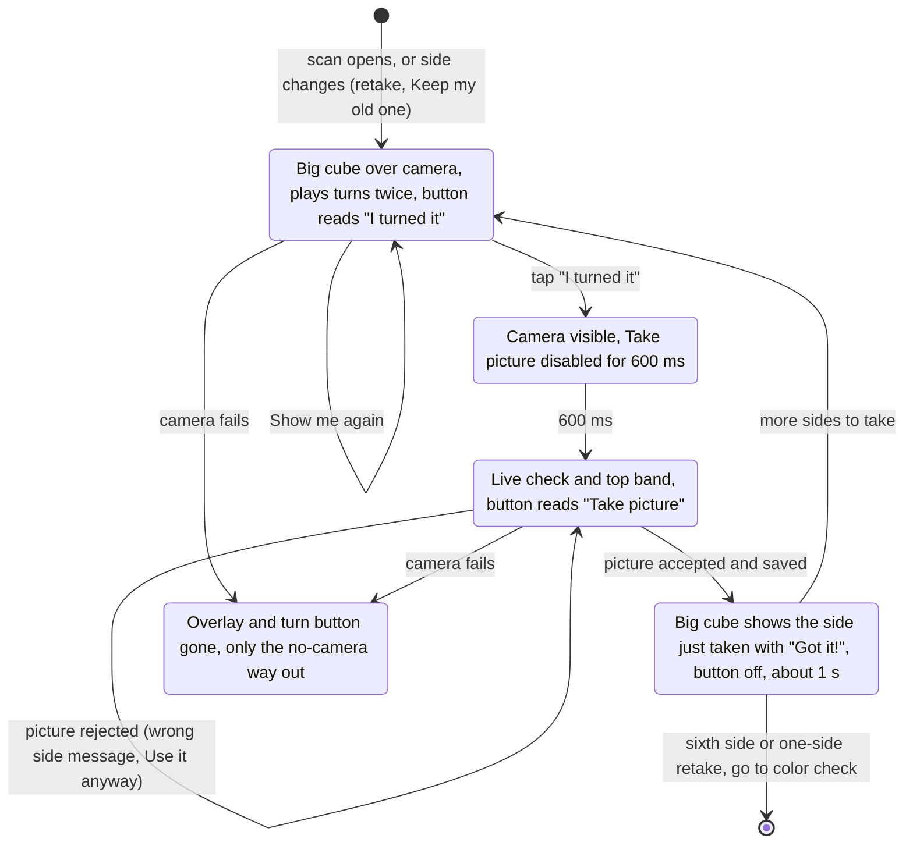

# Clear Scan Turns - Plan

## Goal Capsule

- **Objective:** A child or an older person turns the real cube the right way for each of the six pictures on the first try. They see their own cube fill in with its real colors as they go.
- **Means:** A big moving cube covers the camera box between sides and waits for "I turned it" (KTD3). Both cubes paint each taken side with the colors the camera saw (KTD1, KTD2). A live check and a top-color band help aim before the tap (KTD4, KTD5).
- **Authority:** Product Contract Requirements win on behavior. KTDs win on mechanism. Units cite them and never override them. `docs/plans/2026-11-24-1020-feat-easy-for-every-age-plan.md` still governs the rest of the scan (order, retake, saved session, confirm dialog). This plan changes only how the scan screen guides and shows the turns.
- **Execution profile:** One PR from a feature branch off `main`. `ce-work` builds and checks it. The owner tries it on a real phone and merges. A merge to `main` deploys to GitHub Pages.
- **Stop conditions:** Stop and ask before changing the scan order, the color match (`src/scan/classify.ts`), or the saved-session shape. Stop and ask if the screen cannot fit 360 x 640 without scrolling.

---

## Product Contract

### Summary

Between sides, a big cube covers the camera box. It first shows the side just taken, painted with the colors the camera saw, under a "Got it!" badge. Then it turns the way the real cube must turn, with a big arrow for each turn. It plays twice, then waits until the child taps "I turned it". A small copy of the cube stays beside the words and fills in side by side. While the child aims, a colored band shows which color goes on top. The camera box also says when it sees the right side, or which other side it sees.

### Problem Frame

The owner tried the scan after the last release and still found the turn between sides confusing. Today the turn picture is a 96 px cube beside the words. It plays once, quickly, and it always shows the standard colors, not the child's cube. Nothing on the camera box says which color goes on top. Nothing says the camera sees the wrong side until after the tap.

Other scanners do no better. The ruwix web scanner and qbr show turns as text only, and neither tells the user which color goes on top in the screen itself. Both do paint the scanned colors onto a flat net as faces are taken, and users rely on that to spot mistakes early. No scanner we found paints the colors onto a moving 3D cube. Cube Coach's moving cube is already ahead of them, so this plan builds on it rather than replacing it (Sources).

### Requirements

**Turn guide**

- R1. Before each side, a big cube covers the camera box and plays that side's whole-cube turns one at a time, with a big arrow for the turn that is playing. It plays the turns twice, then rests in the final pose.
- R2. The big cube stays until the child taps the main button, which reads "I turned it" while it shows ("I'm ready" for the first side, which needs no turn). Nothing on the scan moves on by itself.
- R3. "Show me again" under the small cube opens the big cube again and replays the turns.
- R4. The big cube opens when the scan opens, after each accepted picture, and when the side changes by a retake or "Keep my old one". It does not open again after a rejected picture, because the side has not changed.

**Your cube**

- R5. Each taken side shows on both cubes with the colors the camera saw for its 9 squares. A side not yet taken shows gray squares around its colored center.
- R6. The painted sides always match the saved picture samples. This covers a reopened scan, a side taken again, "Keep my old one", and a scan started over after "Keep my cube".
- R7. After an accepted picture, the big cube opens on the side just taken with a "Got it!" badge for about one second, and then plays the turn to the next side. After the sixth picture, or a one-side retake from the color check, the badge shows for about one second and then the app moves on as it does today. The main button is off during that second.

**Aiming help**

- R8. A band along the top edge of the camera box shows the color that goes on top for the current side. A color square next to the hint line shows the same color.
- R9. When the camera's middle square matches the side asked for, the camera box shows a "ready" border, a check mark, and the words "Green side found. Take the picture." (with that side's color name).
- R10. When the camera clearly shows a different side for a short while, the camera box says which side it sees and which side to show. The words say "may be" for colors that are easy to confuse: white and yellow, red and orange.
- R11. The aiming help never stops a tap. "Take picture" behaves as it does today, including the wrong-side message and "Use it anyway".

**Access and fit**

- R12. With reduced motion turned on, the big cube shows the final pose and every arrow at once, and the "Got it!" second still happens. Nothing waits for an animation to end.
- R13. A screen reader hears each side's turn words once, and "Got it" once after each accepted picture. It does not hear the live check as it changes.
- R14. The scan still fits 360 x 640 without scrolling, and the camera squares still line up with the part of the picture the app reads.

### Key Decisions

- **The child taps every picture.** (session-settled: user-directed — chosen over auto-capture: the child keeps control of when a picture is taken.) Governs R2, R11.
- **No voice guide in this plan.** (session-settled: user-directed — chosen over spoken turn words: kept as a later extra.) Governs R13.
- **The big cube waits for "I turned it".** (session-settled: user-directed — chosen over a big cube that closes itself after two plays: nothing moves on by itself, at the cost of one extra tap per side.) Governs R2, R4.

### Success Criteria

- On a real phone, the owner, a child, and an older adult each scan all six sides with no wrong-side message caused by turning the wrong way.
- Each of them can say, from the small cube alone, which sides are done.

### Scope Boundaries

- The scan order, the turn words, the color match, the color check screen, and the saved-session shape do not change.
- No tap-to-fix on the cube. Fixing colors stays on the color check screen.
- Considered and not built:
  - **Auto-capture when the side matches.** The owner chose manual capture.
  - **Snapping each square to the nearest of the six colors.** The camera colors are shown as they are (KTD1). Evidence that would change this: children on a real phone reading dim camera colors as wrong.
  - **A flat net of the scanned colors, as ruwix and qbr show.** The small cube already shows progress, and a net would take height the camera needs (R14).
  - **Phone vibration on an accepted picture.** It was not asked for, and iPhone Safari does not support it.
  - **Announcing the live check to screen readers.** It changes four times a second, and the tap result already speaks (R13).
  - **Working out which way the cube is held from one picture.** One side alone cannot show it. The top-color band asks instead.

#### Deferred to Follow-Up Work

- Spoken turn words (Key Decisions).

### Open Questions

- Deferred to implementation: the exact turn speed, the rest between the two plays, and the live-check distance limit. Start with the values in KTD3 and KTD4, then tune them on a real phone.

### Sources

- Prior art: ruwix web scanner (https://ruwix.com/cube-solver/scan/) and qbr (https://github.com/kkoomen/qbr). Both use manual capture and text-only turn prompts, and both paint scanned colors onto a flat net as faces are taken.
- WCAG 2.2.2 Pause, Stop, Hide (https://www.w3.org/WAI/WCAG22/Understanding/pause-stop-hide) and web.dev on motion (https://web.dev/learn/accessibility/motion): motion that starts by itself needs a way to stop it, and many people never turn on the reduced-motion setting.

---

## Planning Contract

### Key Technical Decisions

- KTD1. **Paint the raw camera colors.** Each taken square is painted with its saved RGB sample, the same color the live chips show today. Snapping each square to the nearest of the six colors was rejected. The full color match on the sixth picture (`classify`) can disagree with a per-square guess, so the cube would show one color and the color check another. The raw colors show glare and dim squares as they really are, which helps the child spot a bad picture early. The mapping needs no rotation: square `i` of the cube face whose `data-color` is a side's center gets `samples[faceStart + i]`, where `faceStart` is that face's index in `FACES` times 9. Research checked every face transform in `src/scan/turn-picture.ts` against `FACE_GEOMETRY` in `src/cube/facelets.ts`, and `tests/scan/scan-flow.test.ts` already pins each step's `cells` to `faceStart + 0..8`.
- KTD2. **One cube component, two copies.** `turnPicture` gains a way to paint from the 54 samples, and a big variant for the camera box. Painting sets the background on the existing square elements, so the center keeps its glow class and the face transforms stay as they are. The screen paints both copies from `flow.samples()` inside `show()`. `show()` runs only after a picture is saved, or after the flow is reset, so a picture waiting on the "delete old work?" dialog is never painted (R6). Size comes from CSS on the stage and view, never from a `scale()` in the cube's inline transform. `tests/scan/turn-picture.test.ts` reads that transform as rotations only. The small copy rests in the current side's final pose and does not animate. The big copy plays from the previous pose, as the picture does today (KTD5 of the earlier plan).
- KTD3. **The big cube is an overlay inside the camera box, and the main button changes role.** The overlay sits above the video inside `.scan-camera`, so the camera keeps running under it and no permission prompt comes back. While it shows, "Take picture" is hidden and an "I turned it" button takes its place in the same slot. "I'm ready" is used when the side has no turns. The two are separate buttons, so tests and screen readers find each by its name. After "I turned it", "Take picture" is `disabled` for 600 ms, with the same dimmed look as during the "Got it!" second, so a double tap cannot take a picture of the side the child is still turning away from. A rejected double-tap picture would also count toward "Use it anyway". If the camera fails, the overlay and its button go away for the rest of that screen, and the existing no-camera way out is the only action. Turn timing starts at 1300 ms per turn, with a 1.0 s CSS transition and a 900 ms rest between the two plays. Both `TURN_MS` and the CSS transition in `src/scan/scan.css` change together. An arrow for each turn shows in both motion modes, and the arrow of the turn that is playing is highlighted. The motion stops after two plays and the overlay closes on a tap, which meets WCAG 2.2.2.
- KTD4. **The live check uses the capture rule plus a distance limit and a short streak.** Each preview tick asks `ScanFlow` how the middle square looks: the side asked for, another clear side, or unclear. "Matches" is exactly the test capture uses (`nearestColor(cells[4]) === step.center`), so the ready border agrees with what "Take picture" accepts. "Another clear side" also needs the Lab distance to that side's nominal color under a limit (`labDist` in `src/scan/sample.ts`), because `nearestColor` always names some color, even for a table or a ceiling. The screen shows "ready" after 2 equal ticks in a row (500 ms) and "another side" after 3 (750 ms), and goes back to the plain words after 2 unclear ticks. The live check is off while the overlay shows, while the "Got it!" second runs, and when the camera has failed. Its words go in the camera pill, which is not a live region (R13). A ready state also hides an old wrong-side message from the last tap. The ready border uses a new success token with the check mark and words, not color alone, because the cube's own green would be unclear on the green side.
- KTD5. **The top band sits inside the camera box's top margin.** It is an absolutely placed strip inside the 8% band above the squares, so it never moves the video or the grid. The grid inset is tied to `GRID_FRACTION` in `src/scan/camera.ts`. The band is decoration (`aria-hidden`), because the hint line already says the top color in words. It is removed with the rest of the camera content when the camera fails.
- KTD6. **Timers drive every beat. Nothing waits for `animationend`.** The global reduced-motion rule in `src/styles.css` turns off all animations and transitions, so an end event would never fire. The "Got it!" second, the overlay plays, and the button lock are `setTimeout` calls. The screen cleanup and `picture.stop()` clear them, the way `turn-picture.ts` already tracks its `timers`. The session is saved before the "Got it!" second starts, so leaving mid-beat loses nothing.

### High-Level Technical Design

One side on the scan screen moves through these states. The live check runs only in "Aiming".

The confirm dialog of the earlier plan sits between "Aiming" and "GotIt" for the first picture of a new scan. "Keep my cube" throws away only the waiting picture, and the saved work stays as it was. The new scan stays in "Aiming" on the green side with nothing painted, because the side did not change.

### Sequencing

U1 first, because U2 and U3 use the paint and big variant. U2 and U3 both touch `src/scan/scan-screen.ts`, so they run in order: U2, then U3.

---

## Implementation Units

### U1. The cube shows the child's real colors and gets a big size

- **Goal:** `turnPicture` paints taken sides from the samples, shows gray for the rest, and has a big variant that plays twice with an arrow for each turn.
- **Requirements:** R1, R3, R5, R12. KTD1, KTD2, KTD3, KTD6.
- **Dependencies:** none.
- **Files:**
  - Modify: `src/scan/turn-picture.ts`, `src/scan/scan.css`
  - Modify: `src/scan/scan-screen.ts` (only to export or move the private `rgbCss` helper, if U1 needs it)
  - Test: `tests/scan/turn-picture.test.ts`
- **Approach:**
  1. Add painting: for each face, a side is taken when all 9 of its samples are present. A taken side paints its 9 squares with the sample colors. A side not taken paints 8 gray squares and its center in the nominal color. Painting changes backgrounds only.
  2. Add a big variant: a class on the picture's root sets bigger stage and view sizes in CSS. The big variant plays the turn list twice with a rest between, then stops in the final pose.
  3. Show an arrow for each turn in both motion modes. During motion, highlight the arrow of the turn that is playing. Under reduced motion keep today's behavior (final pose, all arrows).
  4. Pick a gray that stands apart from the `#0C0D10` face backing and from the dark panel. Add a CSS token for it.
- **Patterns to follow:** the existing `show`/`play`/`stop` and `timers` in `src/scan/turn-picture.ts`, and the token block at the top of `src/styles.css`.
- **Test scenarios:**
  - A full set of 54 samples paints every square of each face with its sample color, square `i` with `samples[faceStart + i]`.
  - With only the green side taken, the green face shows its 9 sample colors, and every other face shows gray squares around a nominal-color center.
  - Painting again with fewer sides taken turns the dropped side back to gray, which covers "Keep my old one" after a retake.
  - After painting, the glowing center keeps its glow class, and each face's `data-color` and inline transform are unchanged.
  - The big variant with one turn plays it, rests, plays it again, and then no more timers fire. The final pose matches the step's hold.
  - During a play, the arrow of the turn that is playing has the highlight, and only that arrow.
  - The cube's inline transform holds only rotations at every step of a big play.
  - With reduced motion stubbed on, the big variant sets the final pose at once and starts no timers.
  - `stop()` clears the second play, so no turn runs after the screen closes.
- **Verification:** The existing turn-picture tests still pass, and the new ones pass.

### U2. The big cube over the camera, "I turned it", and "Got it!"

- **Goal:** The scan screen opens the big cube at the right moments, swaps the main button, runs the "Got it!" second, and paints both cubes.
- **Requirements:** R1, R2, R3, R4, R6, R7, R12, R13, R14. KTD2, KTD3, KTD6. Key Decisions: the child taps every picture, the big cube waits for "I turned it".
- **Dependencies:** U1.
- **Files:**
  - Modify: `src/scan/scan-screen.ts`, `src/scan/scan.css`
  - Test: `tests/scan/scan-screen.test.ts`, `tests/scan.spec.ts`
- **Approach:**
  1. Put the big copy in an overlay inside `.scan-camera`, above the video and grid. Keep the small copy beside the words, resting in the current side's final pose.
  2. In `show()`, paint both copies from `flow.samples()`. Open the overlay only when the side changed since the last `show()` (R4). Track the last shown side index to decide this.
  3. While the overlay shows, hide "Take picture" and show "I turned it", or "I'm ready" when the side has no turns. A tap closes the overlay, starts the 600 ms lock (KTD3), and the camera is visible again.
  4. "Show me again" on the small copy opens the overlay and replays.
  5. After an accepted and saved picture, open the overlay on the side just taken: the big copy shows the pose of that side with the new paint and a "Got it!" badge. After about one second, play the turn to the next side. The badge is `aria-hidden`. "Got it." is added once to the start of the turn words in the existing `aria-live` region (R13).
  6. For the sixth picture and for the one-side retake, show the badge for about one second with the main button off, then call `go('review')` or `toCheck()` as today. Cleanup clears that timer.
  7. Keep the camera box the only part that shrinks on a short screen. The overlay fills the camera box, so it adds no height.
  8. Extend `cameraFailed()`: close the overlay, stop both cube copies' timers, hide "I turned it" and "I'm ready", and never open the overlay again on that screen, even after a side-button retake (KTD3).
- **Patterns to follow:** the lock timer in `src/solve/solve-screen.ts` and `src/practice/practice-screen.ts` (`slowMoveMs`), the hidden-button pattern for `keepOld` and `anyway` in `src/scan/scan-screen.ts`.
- **Test scenarios:**
  - Opening the scan shows the overlay with the start pose and an "I'm ready" button, and no "Take picture" button. Tapping "I'm ready" hides the overlay and shows "Take picture".
  - "Take picture" is disabled for 600 ms after "I turned it", and a tap in that time takes no picture. A tap after 600 ms takes one.
  - A camera failure while the overlay shows leaves no "I'm ready" or "I turned it" button, and none comes back after a side-button retake. The no-camera way out still works.
  - An accepted green picture saves first, then shows "Got it!" on the overlay with the green face painted from the picture. About one second later the turn to red plays, and the button reads "I turned it".
  - A rejected picture (wrong center) does not open the overlay. The wrong-side message and "Use it anyway" work as today.
  - A reopened scan with three sides saved paints those three sides on both cubes and opens the overlay with the starting-hold turns.
  - Retaking a taken side from the side buttons opens the overlay with the starting-hold turns. "Keep my old one" opens it for the side the child was on, and the retaken side keeps its old paint.
  - With saved work and the delete dialog open, the waiting picture is not painted. "Keep my cube" leaves every side gray except centers and asks for the green side again. The overlay does not open again, because the side did not change.
  - The sixth accepted picture shows "Got it!", keeps the main button off, and goes to the color check after about one second. Leaving the screen during that second fires no navigation later.
  - A one-side retake from the color check shows "Got it!" and then returns to the color check on that side.
  - With reduced motion stubbed on, the overlay shows the final pose and all arrows, and "Got it!" still lasts about one second.
  - The turn words region gets "Got it." once after each accepted picture, and the overlay itself is hidden from screen readers.
  - Browser test (`tests/scan.spec.ts`): the full-scan loop taps "I'm ready" or "I turned it" before each "Take picture" and waits out the lock, then still reaches the color check and the green-side retake.
- **Verification:** On a Pixel 7 sized browser, a full scan with the fake camera reaches the color check, and the screen does not scroll at 360 x 640.

### U3. Live side check and top-color band

- **Goal:** While aiming, the camera box says when it sees the right side or another side, and shows which color goes on top.
- **Requirements:** R8, R9, R10, R11, R13, R14. KTD4, KTD5. Key Decisions: the child taps every picture.
- **Dependencies:** U2.
- **Files:**
  - Modify: `src/scan/scan-flow.ts`, `src/scan/scan-screen.ts`, `src/scan/scan.css`, `src/styles.css` (success token)
  - Test: `tests/scan/scan-flow.test.ts`, `tests/scan/scan-screen.test.ts`
- **Approach:**
  1. Add a `ScanFlow` method that takes the 9 live cells and returns "matches", another side's color, or unclear, using the rule in KTD4. Start the limit at a squared `labDist` of 500, about 22 Lab units. That is just under the 539 a mid-gray middle scores against nominal white. Tune it on a phone (Open Questions).
  2. In the preview tick, skip the check while the overlay or "Got it!" shows. Otherwise feed the result through the streak counts in KTD4 and set the camera box state and the pill words.
  3. Ready state: a thick border in the new success token, a check icon, and "<Color> side found. Take the picture." Another-side state: "This is the <seen> side. Show the <asked> side.", with "may be" in place of "is" for white and yellow, or red and orange.
  4. Add the top band inside `.scan-camera` above the grid, colored with the current step's `topColor`. Add a small color square before the hint words.
  5. Reserve the pill's place so its words can change without moving anything.
- **Patterns to follow:** the preview `setInterval` and chip tinting in `src/scan/scan-screen.ts`, the capture check in `ScanFlow.capture`.
- **Test scenarios:**
  - `ScanFlow`: cells whose middle is the asked side's nominal color give "matches", for each of the 6 steps.
  - `ScanFlow`: a middle at another side's nominal color gives that color. A gray or brown middle far from every nominal color gives unclear.
  - Screen: with the preview mock returning a green middle for 2 ticks on the green side, the camera box gets the ready state and the pill says "Green side found. Take the picture."
  - Screen: one green tick alone does not set ready. Then 2 unclear ticks return the pill to "Fit the side inside the squares".
  - Screen: a red middle for 3 ticks on the green side says "This is the red side. Show the green side." A yellow middle on the white side says "may be".
  - Screen: while the overlay shows, preview ticks do not change the pill or the border.
  - Screen: with the wrong-side message showing, a ready state hides it.
  - Screen: "Take picture" still works in every live state, and the wrong-side message and "Use it anyway" still appear after the same failures as today.
  - Screen: the top band takes the step's top color: white for the first four sides, blue for white, green for yellow.
  - Screen: the pill has no `aria-live`, and the camera box squares keep their 8% inset.
  - Screen: after a camera failure, no live state shows and no tick errors.
- **Verification:** In the browser test, the fake camera's green picture shows the ready state on the green side.

---

## Verification Contract

| Check | Command | Proves |
|---|---|---|
| Unit tests | `npm test` | U1 to U3 scenarios, and all earlier scan, session, and screen tests |
| Type check and build | `npm run build` | The app builds for GitHub Pages |
| Browser tests | `npm run build`, then `npm run e2e` | The full scan with the fake camera, the green-side retake, and the 360 x 640 fit |
| Real phone | Open the deployed site or a local HTTPS build on a real phone | Turn speed, live-check limit, and the success criteria. The owner does this before merge |

Run `npm run build` before `npm run e2e`. Playwright reuses a preview server that may already be running, and that server serves the last build.

---

## Definition of Done

- R1 to R14 hold, and every U1 to U3 test scenario has a passing test.
- All existing unit and browser tests pass, with only the changes U2 and U3 name.
- The scan fits 360 x 640 with no scroll, with the overlay open and closed.
- No timer from the scan fires after leaving the scan screen.
- The owner has tried the scan on a real phone and tuned the turn speed and live-check limit, or has accepted the starting values.
- No leftover code from tried-and-dropped approaches is in the diff.
