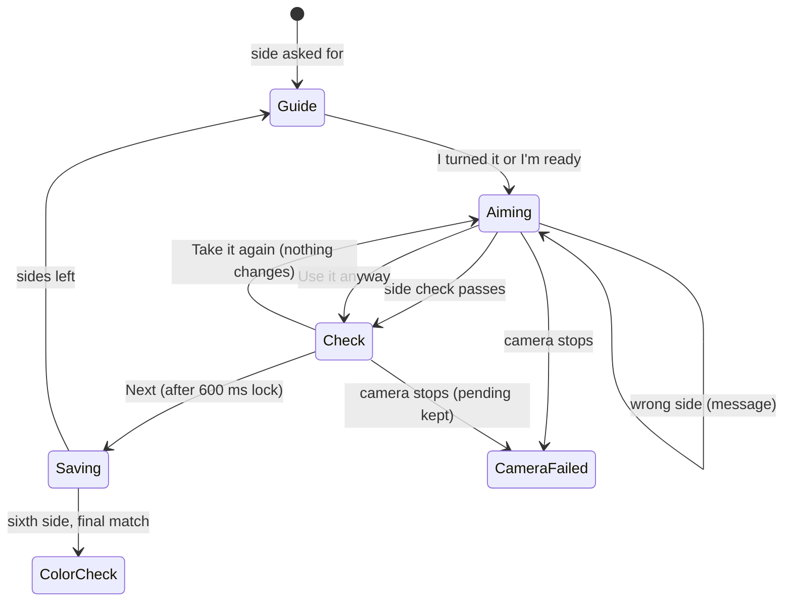
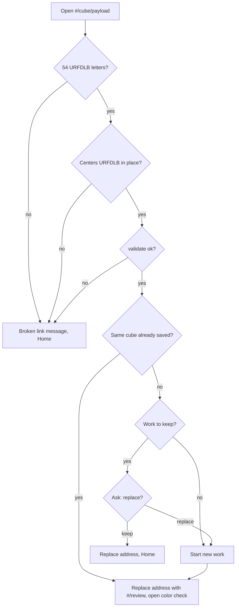

# Scan Check, Better Colors, and Phone Link - Plan

## Goal Capsule

- **Objective:** A child can scan a cube on any common phone browser, catch wrong colors one side at a time, get a correct cube more often, and use a phone scan on a computer, and the known app bugs are gone.
- **Authority:** Product Contract requirements (R) win on behavior. Key Technical Decisions (KTD) win on mechanism within those requirements. Units override neither.
- **Execution profile:** two PRs. PR1 holds the scan and app bug fixes. PR2 holds the per-side check, the better color match, and the phone link. `ce-work` builds the units. The owner tries both PRs on a real phone before each merge (see Open Questions).
- **Stop conditions:**
  - Stop and ask if the camera size targets in R3 cannot be met without removing something a child needs on the scan screen.
  - Stop and ask if the new color match lowers accuracy on any existing classifier test.
  - Stop and ask if the QR library in KTD9 is not MIT or is much larger than about 10 KB gzipped.

---

## Product Contract

### Summary

The scan screen gives the camera a real size on short phones and moves the live words out of the camera box. After each picture, the child sees the colors the app read and taps Next or Take it again. The final color match uses optimal assignment and the rules of real cube pieces. A computer can show a QR code to open the scan on a phone, and the phone can send the checked cube back as a link. A set of app bugs found in a full code read is fixed.

### Problem Frame

Scanning works in tests but is hard in real use.

- **Small camera on Android Brave.** The cause is in the layout, not in Brave. About 449 px of the scan screen is fixed: the top bar, the side buttons, the turn row, the hint, and the 80 px main button. The camera gets only what is left. It is below its 46dvh cap on any screen shorter than about 830 px. Measured in Chromium: 120 px (the floor) at 360x560, 189 px at 360x640, and 249 px at 412x700. Brave's bottom toolbar makes the window shorter. The page never scrolls, so the toolbars never hide. An e2e test (`tests/scan.spec.ts`) locks in "no scrolling at 360x640", and with it the shrinking.
- **Live words cover the grid.** The pill is 90% of the camera's width, so on a small camera it wraps to 2 or 3 lines and covers 53 to 73 px of the grid's bottom row. Even on a 348 px camera it covers 20 to 40 px.
- **Keyboard focus is lost after each picture.** `gotIt()` disables the focused "Take picture" button, then `openGuide()` hides it, and focus drops to the page body.
- **Wrong colors are found only at the end.** The child learns about misreads on the color check after all six sides. By then, they do not know which picture went wrong.
- **Why colors get misread** (from reading `src/scan/classify.ts` and `src/scan/sample.ts`, and from open-source prior art; no real misread pictures were available):
  1. Greedy matching with a cap of 8 per color can lock a wrong cheap pair early and push later stickers into wrong colors.
  2. The match ignores piece rules. A corner with two opposite colors, such as white and yellow, reaches the color check, and the child must find it by hand.
  3. Each side is a separate photo with its own light. Matching compares stickers to centers taken in other photos.
- **No phone on a computer.** A computer often has no back camera, and there is no way to scan with a phone and use the result on the computer.
- **App bugs.** A full code read found bugs in update handling, the solver fallback, history, focus, and saved-work edge cases (R14 to R19).

### Requirements

**Scan screen**

- R1. Keyboard focus follows the main control through every step of a scan: aim, check, turn guide, and aim again. It never drops to the page body.
- R2. Live words about the side in view never cover any square of the scan grid, at any camera size.
- R3. At 360x560 the camera square is at least 240 px, and at 360x640 it is at least 280 px. At both sizes, the main button is fully visible without scrolling. Below those heights, the page may scroll.
- R4. "Take picture" before the camera has a frame says that the camera is starting, instead of doing nothing.
- R5. If the camera stops in the middle of a scan, for example because permission is revoked or another app takes it, the screen shows the existing camera-failed state. Saved sides stay saved.
- R6. The scan screen keeps the phone screen on while it is open, as Solve and Learn do.

**Per-side check**

- R7. After a picture passes the side check, the child sees the 9 colors the app read for that side, each with its color name, and picks Next or Take it again.
- R8. Nothing is saved, and the scan does not move on, until the child taps Next.
- R9. Take it again leaves the scan exactly as it was before that picture. This includes a retaken side's old picture and a later "Keep my old one".
- R10. Back, refresh, or leaving during the check keeps every saved side and drops only the unchecked picture.
- R11. When the final color match gives a square a different color than the child saw on that side's check, the color check flags that square, with words that do not blame the light.

**Color reading**

- R12. The final color match gives the lowest total color difference while it keeps exactly 9 of each color. It never leaves an impossible piece when a close second choice makes the piece real.
- R13. Accuracy does not drop on any existing classifier test, and new test cases for a greedy trap and for red/orange and white/yellow piece conflicts pass.

**Phone and computer**

- R14. On a computer, the scan screen offers "Scan with your phone". It shows a QR code that opens the app's scan screen, and the same link as text. It also shows when the camera fails.
- R15. On the color check, once the colors make a real cube, the child can tap "Send to computer". This opens the share sheet, or else copies the link, and shows the link as text either way.
- R16. Opening a cube link checks the link fully before anything changes. It asks before replacing saved work, opens the color check with the cube, and removes the cube from the address.
- R17. A broken or impossible cube link shows a plain message and a way Home. Nothing saved changes.

**App fixes**

- R18. After a new version is deployed, an app that is already open keeps working, including the 3D cube, until its next fresh start.
- R19. These bugs from the code read are fixed:
  - A solver worker that fails falls back to the main thread. The child is never told that a valid cube cannot be solved.
  - Back to the color check after a scan that started over returns to the scan, or to Home. It never shows a blank color check that can drop the scan.
  - Back after a finished scan, or after a one-side retake, does not reopen the camera.
  - Keyboard focus stays on the pressed control in the color check, Solve, and Learn when they redraw.
  - Color fixes made after a scan that read as solved are kept and offered by "Keep going".
  - Looking at the colors after a finished Solve does not bring the solved work back as "Keep going".
  - `#/review/<word>` with a word such as `constructor` does not crash the color check.

### Key Decisions

- **The check shows the colors the app read, not the raw camera colors.** The child judges the app's answer, and this replaces the 1-second "Got it!". (session-settled: user-approved — chosen over keeping the raw-color "Got it!" beat: the child must judge what the app will use.) Governs R7, R11.
- **The phone sends the cube back as a link, with no server.** (session-settled: user-approved — chosen over a live link through a free outside relay: no outside service, works offline, and the cube is under 100 bytes.) Governs R14, R15, R16.
- **The camera keeps its size, and the page may scroll on short screens.** (session-settled: user-approved — chosen over keeping the no-scroll rule that shrinks the camera.) Governs R3.
- **2x2 and 4x4 cubes move to their own plan, with scan and solve only.** Learn and practice stay 3x3. (session-settled: user-approved — chosen over adding them in this plan: neither cube has fixed centers, so scanning works differently, and there is no 4x4 solver in the current libraries.)
- **Carried forward from the earlier scan work:** manual "Take picture" with no auto-capture, no voice guide, and the big turn cube waits for "I turned it". (session-settled: user-directed — chosen over auto-capture, spoken turn words, and a guide that closes itself.) Governs R7, R8.

### Key Flows

- F1. One side, from aim to saved
  - **Trigger:** the child taps "Take picture" while the side is in view.
  - **Steps:** the side check passes, then the check panel shows 9 colors, then Next saves the side and opens the turn guide for the next side. Take it again goes back to aiming with nothing changed. On the sixth side, Next runs the final match and opens the color check.
  - **Covered by:** R7, R8, R9, R10, R11
- F2. Phone to computer
  - **Trigger:** on a computer, the child picks "Scan with your phone".
  - **Steps:** the child scans the QR code with the phone. The phone opens the scan, the child scans and checks the colors, then taps "Send to computer". The child opens the link on the computer, and the computer checks it, asks if there is saved work, and opens the color check.
  - **Covered by:** R14, R15, R16, R17

### Acceptance Examples

- AE1. Covers R9. **Given** the child is retaking the blue side mid-scan, **when** they take a picture, tap Take it again, and then tap "Keep my old one", **then** the old blue picture is still saved and the scan returns to the side it came from.
- AE2. Covers R10. **Given** the sixth picture is on the check panel, **when** the child refreshes the page, **then** the scan reopens on the sixth side with five sides saved, and the color check has not run.
- AE3. Covers R16, R17. **Given** a cube link whose centers are in the wrong places, **when** it is opened on a computer with saved work, **then** the computer shows "This link does not hold a cube we can use", and the saved work is unchanged.
- AE4. Covers R16. **Given** the cube link is for the same cube that is already saved, **when** it is opened, **then** no question is asked, and Solve and Learn progress are kept.

### Success Criteria

- On a real Android phone in Brave, the camera square is big enough to fill with a cube at arm's length, and the child never has to scroll to reach the main button at the phone's normal browser size.
- In a real scan, a misread side is caught on its own check, before the sixth side.

### Scope Boundaries

- Learn and practice stay 3x3 only.
- No server, account, or outside relay.
- The phone link carries only the cube's colors, never saved progress or settings.

#### Considered and not built

- **Live relay through a free signaling service, such as PeerJS cloud.** It adds a third-party server and breaks offline use, for a payload under 100 bytes. Revisit if children cannot get the link to the computer in real use.
- **The computer's webcam reading a QR code from the phone.** It needs a webcam and a barcode reader that is not on all desktop browsers.
- **White balance from the white center, a glare mask, CIEDE2000, and locking camera white balance or exposure.** Research ranks these below optimal assignment and piece repair, and iOS gives no camera control. Revisit if, after U8, real scans still mix up white and yellow or drift between sides.
- **A "Try again" button that restarts the camera after it fails.** R5 uses the existing failed state, which offers typing the colors. Revisit if real users hit camera stops often.
- **Syncing two open tabs.** An open tab can overwrite an imported cube on its next save. This is an existing app-wide limit.
- **Hiding "Use it anyway" once the right side is found.** After PR2, "Use it anyway" goes through the check panel, so the child sees the wrong colors and can take the side again.

#### Deferred to Follow-Up Work

- **2x2 and 4x4 cubes (own plan).** What that plan starts from:
  - `cubing/search` 0.66 exports `experimentalSolve2x2x2`, so 2x2 solving is available.
  - There is no 4x4 solver in `cubing` or `cubejs`. The known open solvers are C++ (Mcube, GPLv2) or scramblers only (cstimer, GPLv3). A 4x4 solve needs a reduction step: pair the edges, solve as a 3x3 with `cubejs`, then fix parity.
  - Side identity, the wrong-side check, the live words, and the color match all use center stickers, which neither cube has. Scans need clustering into 6 equal groups and an orientation taken from one fixed corner.
  - Blast radius: `src/cube/facelets.ts`, `src/cube/validate.ts`, `src/scan/*`, `src/review/net-editor.ts`, `src/review/smart-fill.ts`, `src/app/session.ts` (a size field), and `src/ui/player.ts` (`puzzle` id). Learn entry points must be fenced off.
  - The cube link in KTD10 already tells sizes apart by length (24, 54, 96).

### Sources

- Layout measurements, the save-order trap, and the router limits come from a code read and a headless Chromium run (Pixel 7 profile, fake camera) of this repo.
- dwalton76/rubiks-color-resolver (MIT), https://github.com/dwalton76/rubiks-color-resolver — color resolution checked against valid corner triples and edge pairs.
- "Color Recognition for Rubik's Cube Robot", https://ar5iv.labs.arxiv.org/html/1901.03470 — red and orange overlap as the light changes, and relative methods beat fixed thresholds.
- W3C Image Capture implementation status, https://github.com/w3c/mediacapture-image/blob/main/implementation-status.md — white balance and exposure controls exist on Android Chrome only.
- WebKit bug 270779, https://bugs.webkit.org/show_bug.cgi?id=270779 — iOS Safari torch and white balance support is unclear.
- Brave community report "Brave Mobile treats svh like dvh" (v1.65) — the one Brave-specific viewport report found.
- qrcode-generator (MIT, about 7 KB gzipped), https://github.com/kazuhikoarase/qrcode-generator

---

## Planning Contract

### Key Technical Decisions

- KTD1. **The camera gets a size first, and the other parts fit around it.** The scan column order becomes: the top bar, the side buttons, a one-line headline, the camera, the live line (KTD2), and the main button slot. The turn row, the hint, "Keep my old one", and "Use it anyway" go below the main button slot. Problem messages (wrong side, camera starting) show in the live line's place, in an element with `role="alert"`, replacing the live words while shown, so a tap never looks like it did nothing on a short screen (R4). The camera box stops taking "the rest of the height". Instead, its size is the smaller of the content width and a height share of the small viewport (`svh`), with a px floor that meets R3. "Show me again" moves beside the small cube instead of under it, and the main button can shrink from 80 to 64 px if the R3 numbers need it. The e2e "no scroll at 360x640" test is replaced by R3's checks at 360x560 and 360x640, plus a 412x700 check that guards larger phones. Rationale: the cause is the remainder sizing, so moving the camera up and fixing its size removes the cause, whatever toolbars a browser has.
- KTD2. **The live words move out of the camera box into one fixed-height line under it.** The words become short ("Green side found", "That looks like yellow", "Fit the side in the squares"). Inside the camera, the green border and a check mark stay as the visual signal. The line keeps a fixed height, so the main button never jumps, and it stays out of the live region, as before. Rationale: any pill inside the camera covers part of the grid on some camera size.
- KTD3. **One focus rule lives in `mainButton()`.** If the focused element is about to be hidden, focus moves to the newly shown main control. This one rule covers take, check, guide, and take again (R1), and it is extended by U7 for the Next button.
- KTD4. **`ScanFlow` checks a picture without accepting it.** `capture` only checks the side and returns the cells as pending. A new accept step on Next does what `accept` does now: write the stickers, move the index, and clear the retake marker. `useAnyway` returns a pending picture the same way. The save in `scan-screen.ts` moves from before the beat to Next. Rationale: today `capture` calls `accept` at once, so Take it again could not undo the move, and in a retake the old picture would already be overwritten in memory.
- KTD5. **The per-side check colors are a pure function of that side's 9 samples.** The side's own center is the reference for its own color, and the nominal sticker colors are the references for the other five. A side taken with "Use it anyway" uses nominal colors for all six. After the sixth side, the final match runs over all 54 samples. Any square whose final color differs from its side's check color is added to `checkMe`. Rationale: the check colors can be computed again at the end from saved samples alone, so a refresh or a retake needs no new saved field and no session version bump. A version bump would delete every saved scan.
- KTD6. **The check panel sits in the camera box, outside the `aria-hidden` turn guide.** It is a 3x3 of plain squares (not buttons) in camera order (the order the child sees). Each square shows its color, its color name as short visible text (for example "White"), and an `aria-label` such as "Square 3, white" (R7). The text color comes from `TEXT_ON`, as in the color-check zoom grid (`src/review/net-editor.ts`). While the panel shows, the main button slot holds two buttons side by side, "Take it again" and "Next", so both stay visible wherever the main button does (R3). Next gets the same 600 ms lock as "Take picture" after "I turned it", so a double tap cannot confirm blindly. The live check pauses while the panel shows. `cameraFailed()` keeps a pending check, so Next still works. The scan text announces one short line, "Check the colors.", not nine colors.
- KTD7. **The final match uses optimal assignment instead of greedy matching.** It solves a min-cost assignment of the 48 non-center stickers to 48 slots (8 per color), with the Hungarian method written in the repo (about 40 lines, no new dependency). The "close call" rule for `checkMe` stays. Whether the lightness weight in `labDist` should stay at 0.5 for center-referenced matching is measured against the classifier tests during U8 (see Deferred to Implementation).
- KTD8. **A piece repair runs after the assignment, on close calls only.** After the assignment every color has exactly 9, so a single color change always breaks the count. The repair therefore swaps pairs: for each impossible corner or edge, look for two close-call stickers A (read X, second choice Y) and B (read Y, second choice X), with at least one of them in that piece. Swap both, and keep the swap only if every piece it touches is real afterward and the number of impossible pieces goes down. The piece tables and placement helper move from `src/review/smart-fill.ts` to `src/cube/facelets.ts`, so smart fill and the classifier share one copy. Rationale: research ranks piece rules as the largest gain for red/orange and white/yellow, and the repo already has the tables.
- KTD9. **The QR code uses `qrcode-generator` (MIT), loaded only when needed.** It is black on white with a 4-module quiet zone and at least 160 px wide, with an `aria-label` and the link as text beside it. The QR shows on the scan screen when `matchMedia('(any-pointer: coarse)')` is false, and in the camera-failed state. The link is `location.origin + location.pathname + '#/scan'`, never a hard-coded `/`, because the site lives under the repo path on GitHub Pages. Rationale: a pointer check is one line and needs no camera permission. Detecting "no back camera" would need `enumerateDevices`, which hides device details until permission is given. A laptop with a touch screen may miss the option, but the camera-failed state still shows it. A hand-written QR encoder was rejected: QR error correction is easy to get wrong, and the library is small.
- KTD10. **The cube link is `#/cube/<54 face letters>`.** The 54 URFDLB letters are already the solver's format and safe in a URL (the router splits on `/`). A new `cube` route checks the link in this order before it asks anything:
  1. Take the first 54 characters after `cube/`, upper-cased, and ignore anything after them (some messengers add tracking text).
  2. Every character is one of URFDLB.
  3. The centers are U, R, F, D, L, B at `CENTER_INDEX`. `validate()` alone is not enough, because `wellFormed()` in `src/app/session.ts` deletes saved data whose centers are moved.
  4. `validate()` says the cube is real.

  Then: if the same cube is already saved, skip the question. Otherwise ask with `confirmDelete` when `hasWorkToKeep()`. Start new work with the colors and facelets, and replace the address with `#/review` while keeping the router's history state. The payload is never written into the page.
- KTD11. **"Send to computer" lives on the color check.** It is enabled under the same condition that enables Solve. It calls `navigator.share({ url })` when present, else `navigator.clipboard.writeText`, and always shows the link as selectable text. Rationale: the color check is the first place where the colors are known to make a real cube, and it is where a phone scan ends. Solve was rejected as the place, because a child who wants the cube on a computer should not have to start solving on the phone first.
- KTD12. **The service worker waits for a fresh start.** Set `registerType: 'prompt'` with no prompt UI. The new worker then takes over only after every app window has closed, so an open app keeps its old cached files. The built `sw.js` must no longer run `self.skipWaiting()` and `clientsClaim()` at load. Workbox still writes a `skipWaiting` call inside a `SKIP_WAITING` message listener in prompt mode, and that is expected.
- KTD13. **`go()` gets a replace option for steps that should not stay in history.** The scan uses it when it moves to the color check, after a full scan and after a one-side retake. It uses `location.replace`, so Back from the color check does not reopen the camera.

### High-Level Technical Design

Scan screen states after PR2:

Cube link import:

### Deferred to Implementation

- The exact `svh` share and px floor in KTD1, chosen so that R3 holds at all three test sizes.
- Whether `labDist`'s 0.5 lightness weight helps or hurts center-referenced matching. Keep whichever setting passes more classifier cases.
- The final short wording of the live line and the check panel words, within the house rules for child-facing words.

---

## Implementation Units

| U-ID | Title | Main files | Depends on |
|---|---|---|---|
| U1 | Camera size and live line | `src/scan/scan-screen.ts`, `src/scan/scan.css` | none |
| U2 | Scan focus, camera states, screen on | `src/scan/scan-screen.ts`, `src/scan/camera.ts` | U1 |
| U3 | App bug fixes | `vite.config.ts`, `src/solve/fast-solve.ts`, `src/review/net-editor.ts`, `src/app/session.ts`, `src/app/router.ts` | none |
| U4 | Focus kept on redraw | `src/review/net-editor.ts`, `src/solve/solve-screen.ts`, `src/learn/learn-screen.ts` | U3 |
| U5 | Check without accept in ScanFlow | `src/scan/scan-flow.ts` | PR1 |
| U6 | Per-side check colors | `src/scan/classify.ts` | PR1 |
| U7 | Per-side check panel | `src/scan/scan-screen.ts`, `src/scan/scan.css` | U5, U6 |
| U8 | Optimal match and piece repair | `src/scan/classify.ts`, `src/cube/facelets.ts`, `src/review/smart-fill.ts` | U6, U7 |
| U9 | Cube link import | `src/app/cube-link.ts`, `src/main.ts` | PR1 |
| U10 | Send to computer and phone QR | `src/review/net-editor.ts`, `src/scan/scan-screen.ts`, `src/ui/qr.ts` | U9 |

### PR1: Scan and app fixes

Waits on: nothing.

### U1. Camera size and live line

- **Goal:** the camera keeps a usable size on short phones, and the live words never cover the grid.
- **Requirements:** R2, R3
- **Dependencies:** none
- **Files:** `src/scan/scan-screen.ts`, `src/scan/scan.css`, `src/styles.css`, `tests/scan.spec.ts`, `tests/scan/scan-screen.test.ts`
- **Approach:**
  1. Reorder the `.fit` column per KTD1, and give `.scan-camera-box` a fixed size from width and `svh` with a px floor.
  2. Move "Show me again" beside the small cube, and shrink the main button only if R3 needs it.
  3. Replace the in-camera pill with the fixed-height live line under the camera (KTD2). Keep the ready border and check mark in the camera. Show problem messages in the live line's place (KTD1), and move "Keep my old one" and "Use it anyway" below the main button.
  4. Rewrite the e2e fit test as R3's checks.
- **Patterns to follow:** the token sizes in `src/styles.css` (`--tap`, `--tap-take`), and the existing `.scan-camera.ready::after` border.
- **Test scenarios:**
  - At 360x560, the camera square is at least 240 px and the main button's bottom edge is inside the viewport (e2e).
  - At 360x640, the camera square is at least 280 px and the main button is fully visible, both with the turn guide open and closed (e2e).
  - At 412x700, the camera square is at least 280 px (e2e guard for larger phones).
  - At 360x560 and 360x640 with "Keep my old one" showing (a mid-scan retake), the main button is still fully visible (e2e).
  - At 360x560, a wrong-side picture shows its message above the main button's bottom edge (e2e).
  - The live line's box does not overlap the scan grid's box at 360x560 and 412x700 (e2e).
  - The live line keeps the same height when its words change from "Fit the side in the squares" to "Green side found" (unit, jsdom: same class and fixed height rule; e2e: same measured height).
  - The grid still keeps its 8% inset (existing e2e).
- **Verification:** the R3 checks pass in Playwright, and a screenshot at 360x560 shows the camera above the fold with the main button visible.

### U2. Scan focus, camera states, screen on

- **Goal:** keyboard focus never drops during a scan, and the camera's start and stop are handled.
- **Requirements:** R1, R4, R5, R6
- **Dependencies:** U1
- **Files:** `src/scan/scan-screen.ts`, `src/scan/camera.ts`, `tests/scan/scan-screen.test.ts`
- **Approach:**
  1. Add the focus rule to `mainButton()` (KTD3).
  2. In `capture()`, when `grabCells` returns nothing, show "The camera is starting. Try again in a moment." as a problem message in the live line's place (KTD1).
  3. Listen for `ended` on the video track and go to `cameraFailed()`. Do not remove saved sides.
  4. Call `keepScreenOn()` on open and release it in the cleanup.
- **Patterns to follow:** `keepScreenOn()` use in `src/solve/solve-screen.ts`, and the `cameraFailed()` path.
- **Test scenarios:**
  - Focus "Take picture", take a good picture, and let the beat end. Focus is on "I turned it" (fake timers).
  - Focus "I turned it" and press it. After the lock, focus is on "Take picture" (existing behavior kept).
  - Tap "Take picture" while the fake camera has no frame. The problem message says the camera is starting, and nothing is saved.
  - Fire `ended` on the fake track after two sides are saved. The camera-failed state shows, and the session still has two sides.
  - Opening the scan screen requests a wake lock, and leaving it releases the lock (mocked `keepScreenOn`).
- **Verification:** the new tests pass, and a keyboard-only run through two sides in the browser never shows focus on the body.

### U3. App bug fixes

- **Goal:** fix the update, solver, history, and saved-work bugs found in the code read.
- **Requirements:** R18, R19
- **Dependencies:** none
- **Files:** `vite.config.ts`, `src/solve/fast-solve.ts`, `src/review/net-editor.ts`, `src/app/session.ts`, `src/app/router.ts`, `src/scan/scan-screen.ts`, `tests/solve/fast-solve.test.ts`, `tests/review/net-editor.test.ts`, `tests/app/session.test.ts`, `tests/app/router.test.ts`
- **Approach:**
  1. Service worker per KTD12.
  2. In `fast-solve.ts`, after a worker failure, mark the worker broken and stop creating new ones. Run every solve that was waiting on the worker on the main thread instead of rejecting it, and send later solves to the main thread too. Each main-thread solve runs inside a promise, so a throw there reaches `.catch()`.
  3. In `reviewScreen`, when not manual and nothing is saved, go to `scan` if `session.route` is `scan`, else Home.
  4. Add the replace option to `go()` (KTD13) and use it for the scan's moves to the color check.
  5. In `isFinished()`, do not treat a solved `facelets` as finished while the route starts with `review`.
  6. In `reviewScreen`, do not set the route to `review` on open when the work is finished.
  7. Use `Object.hasOwn(FACE_OF_COLOR, param)` for the side param.
- **Patterns to follow:** the guard style in `src/app/session.ts`, and the `replaceState` pattern in `src/solve/solve-screen.ts`.
- **Test scenarios:**
  - A worker that errors on its first solve makes the next solve return a main-thread solution, and no second worker is created.
  - The worker fires `onerror` while a solve is waiting. That solve resolves with a main-thread solution.
  - A main-thread solve that throws rejects the promise instead of hanging.
  - Open `#/review` with no saved colors and `route: 'scan'`. The app goes to the scan.
  - Open `#/review` with no saved colors and no scan. The app goes Home.
  - After the sixth side, the color check replaces the scan entry in history, and Back goes to the screen before the scan.
  - A scan that read as solved, followed by a color fix, makes `isFinished()` false and `hasWorkToKeep()` true.
  - Opening the color check on a finished Solve leaves `isFinished()` true.
  - `#/review/constructor` renders the color check with no side focused and no error.
  - The built `dist/sw.js` contains `SKIP_WAITING` and no `clientsClaim`, so it does not take over at load (a small test that reads the built file).
- **Verification:** the unit tests pass, and in a built preview, deploying a second build while the app is open does not blank the 3D cube on Solve.

### U4. Focus kept on redraw

- **Goal:** keyboard and switch users keep their place when the color check, Solve, or Learn redraws.
- **Requirements:** R19
- **Dependencies:** U3
- **Files:** `src/review/net-editor.ts`, `src/solve/solve-screen.ts`, `src/learn/learn-screen.ts`, `tests/review/net-editor.test.ts`, `tests/solve/solve-screen.test.ts`, `tests/learn/learn-screen.test.ts`
- **Approach:**
  1. Color check: before a redraw, note the focused control's `aria-label`. After it, focus the new control with the same label.
  2. Solve: call `replaceChildren` on the controls only when the set of buttons changes. When the unlock timer fires, focus the pressed button again.
  3. Learn: reuse one Next button, as Solve does.
- **Patterns to follow:** `closeGuide()` focus restore in `src/scan/scan-screen.ts`.
- **Test scenarios:**
  - Focus square 3 in the zoom grid and pick it. After the redraw, focus is on square 3.
  - Focus the white swatch and pick it. After the redraw, focus is on the white swatch.
  - Focus "Next move" in Solve and press it. After the lock, focus is on "Next move".
  - Focus Next in Learn and press it. Focus is on Next after the redraw.
- **Verification:** keyboard-only, a child can fix three squares in a row without pressing Tab again.

### PR2: Per-side check, better colors, and phone link

Waits on: PR1, merge order only. PR1 fixes a live bug that makes scanning hard on Android Brave, so it must reach production before this larger work is ready.

### U5. Check without accept in ScanFlow

- **Goal:** a picture can be checked, shown, and then dropped or accepted, with no change to the flow until it is accepted.
- **Requirements:** R8, R9, R10
- **Dependencies:** PR1
- **Files:** `src/scan/scan-flow.ts`, `tests/scan/scan-flow.test.ts`
- **Approach:** split `capture` and `useAnyway` per KTD4. The pending picture lives only in memory. The rejected-picture count and the wrong-side message stay as they are.
- **Execution note:** write the scan-flow tests for AE1 first. They pin the retake behavior that the split must keep.
- **Test scenarios:**
  - Covers AE1. Retake blue, capture a good picture, drop it, then keep the old one. The old blue samples are unchanged, and the index returns to the side it came from.
  - Capture a good picture and drop it. `index`, `inOrder`, `taken()`, and `samples()` are the same as before the capture.
  - Capture a good picture and accept it. The result equals today's `capture` result (stickers written, index moved, retake marker cleared).
  - Two wrong-side pictures, then "Use it anyway". It returns the rejected cells as pending, and accepting them stores them as today.
  - A wrong-side picture still increases the failure count and returns the same message as today.
- **Verification:** all old scan-flow tests pass with the new accept step added where they took a picture.

### U6. Per-side check colors

- **Goal:** compute the colors shown on a side's check from that side's 9 samples alone.
- **Requirements:** R7, R11
- **Dependencies:** PR1
- **Files:** `src/scan/classify.ts`, `tests/scan/classify.test.ts`
- **Approach:** add a pure function per KTD5 that takes a side's 9 samples, its asked color, and whether it came from "Use it anyway", and returns 9 colors. Reuse `toLab`, `labDist`, and `nominalLab` from `src/scan/sample.ts`. The center square always gets the asked color.
- **Test scenarios:**
  - A clean green side under room light returns its true 9 colors.
  - A warm-light side where white looks yellowish, with a white center, returns white for the white stickers, because the side's own center is the white reference.
  - A "Use it anyway" side uses nominal references for all colors, so its stickers are not pulled toward the wrong center.
  - The same 9 samples always return the same 9 colors.
- **Verification:** the function is covered by the cases above and needs no session data.

### U7. Per-side check panel

- **Goal:** the child sees each side's colors and taps Next or Take it again, and the scan saves only on Next.
- **Requirements:** R1, R7, R8, R9, R10, R11
- **Dependencies:** U5, U6
- **Files:** `src/scan/scan-screen.ts`, `src/scan/scan.css`, `src/scan/turn-picture.ts`, `tests/scan/scan-screen.test.ts`, `tests/scan.spec.ts`
- **Approach:**
  1. Replace `gotIt()` and the "Got it!" badge with the check panel (KTD6).
  2. `capture()` shows the panel for a pending picture. Next accepts it, then runs today's save path: the first-picture replace question, `startNewWork` or `saveSession`, and on the sixth side the final match.
  3. Take it again drops the pending picture and returns to aiming, with "Take picture" enabled after the lock.
  4. The one-side retake shows the `mergeSide` result on the panel, so the child sees exactly what will be saved.
  5. Disable the side buttons and hide "Keep my old one" and "Use it anyway" while the panel shows. `show()` brings them back from the flow's state.
  6. Extend the focus rule so Next gets focus when "Take picture" had it.
  7. Remove the big cube's "Got it" pose code if nothing else uses it.
- **Patterns to follow:** the zoom grid markup in `src/review/net-editor.ts` (letters, `aria-label`, `TEXT_ON`), and the `LOCK_MS` lock.
- **Test scenarios:**
  - Take a good picture. The panel shows 9 squares with color names, and the session is unchanged.
  - Tap Next. The side is saved, and the turn guide for the next side opens.
  - Tap Take it again. Nothing is saved, the flow index is unchanged, and "Take picture" is enabled after the lock.
  - Tap "Take picture" twice fast. The second tap lands on Next while it is locked and does not save the side.
  - At 360x560 and 360x640 with the check panel showing, both "Take it again" and "Next" are fully visible (e2e).
  - Each panel square shows its color name as visible text.
  - Covers AE2. With five sides saved and the sixth on the panel, re-create the screen from the saved session. The scan opens on the sixth side, and `classify` has not run.
  - Sixth side, Next. The final match runs once and the app goes to the color check, replacing the scan in history.
  - One-side retake: the panel shows the merged colors, Next merges and goes back to the color check, and Back before Next leaves the saved cube unchanged.
  - With saved work and a fresh scan, the replace question appears after Next on the first side, not before the panel.
  - Camera stops while the panel shows. The camera-failed state shows, and Next still saves the pending side.
  - Reduced motion: the panel shows with no animation, and Next and Take it again work.
  - Keyboard: focus moves from "Take picture" to Next, then to "I turned it" (R1).
  - The e2e scan loop taps Next after each side and still reaches the color check with the fake camera.
- **Verification:** a full fake-camera scan in Playwright passes with a Next tap per side, and screenshots at 360x640 show the panel inside the camera box.

### U8. Optimal match and piece repair

- **Goal:** fewer misread squares after six sides, and flags on squares that changed since the child's check.
- **Requirements:** R11, R12, R13
- **Dependencies:** U6, U7
- **Files:** `src/scan/classify.ts`, `src/cube/facelets.ts`, `src/review/smart-fill.ts`, `src/review/net-editor.ts`, `src/scan/scan-screen.ts`, `tests/scan/classify.test.ts`, `tests/review/smart-fill.test.ts`, `tests/review/net-editor.test.ts`
- **Approach:**
  1. Replace the greedy loop in `matchSquares` with the min-cost assignment (KTD7). Keep the close-call list. `mergeSide`'s use of `matchSquares` keeps working with partial caps.
  2. Move the piece tables and placement helper to `src/cube/facelets.ts`, and point `smart-fill.ts` at them (KTD8).
  3. Add the piece repair after the assignment (KTD8).
  4. In the sixth-side save, compare the final colors with each side's check colors (U6) and add differences to `checkMe`.
  5. Change the color check's dashed-ring words to neutral words, such as "Check the squares with a dashed ring once more."
  6. Measure the lightness weight (Deferred to Implementation) against the classifier tests and keep the better setting.
- **Execution note:** add the greedy-trap and piece-conflict test cases first, and see them fail on the current code.
- **Test scenarios:**
  - A built case where greedy matching assigns one sticker wrong and strands another. Optimal assignment gets both right.
  - A built case with one red and one orange sticker swapped by light, whose corner is impossible as read. The repair swaps them, and the cube validates.
  - A white sticker on one edge reads yellow, and a yellow sticker on another piece reads white, both close calls, so the first edge is impossible. The paired swap fixes both, and every touched piece is real.
  - A conflict where no close-call swap makes the piece real. Nothing changes, and the squares stay flagged.
  - The existing room-light and warm-lamp accuracy bars still pass.
  - Every result has exactly 9 of each color.
  - A square whose final color differs from its side's check color is in `checkMe`. A square that matches is not.
  - Smart fill tests pass unchanged after the table move.
- **Verification:** the classifier test suite passes with the new cases, and no test's accuracy bar was lowered.

### U9. Cube link import

- **Goal:** a cube link opened on any device becomes the saved cube, safely.
- **Requirements:** R16, R17
- **Dependencies:** PR1
- **Files:** `src/app/cube-link.ts`, `src/main.ts`, `tests/app/cube-link.test.ts`, `tests/smoke.spec.ts`
- **Approach:** register a `cube` screen that runs KTD10's checks in order, shows a plain message screen with a Home button for a broken link, and otherwise follows the KTD10 flow. Clear the hash on "Keep my cube" and on Esc too.
- **Patterns to follow:** `startNewWork` and `confirmDelete` use in `src/scan/scan-screen.ts`, `wellFormed()` checks in `src/app/session.ts`, and the `addInitScript` session seeding in `tests/smoke.spec.ts`.
- **Test scenarios:**
  - A valid 54-letter link with no saved work opens the color check with the cube, and the address becomes `#/review`.
  - Lower-case letters are accepted.
  - A valid link followed by `?fbclid=abc` is accepted.
  - 53 letters, a letter outside URFDLB, or an empty payload shows the broken-link message, and the session is unchanged.
  - Covers AE3. Centers moved, with saved work. The broken-link message shows, and saved work is unchanged.
  - A link with correct centers but a twisted corner (`validate()` fails) shows the broken-link message.
  - With saved work, a valid link asks first. "Keep my cube" goes Home with the session unchanged and the address cleared.
  - Covers AE4. The same cube as the saved one opens with no question, and Solve progress is kept.
  - Refresh after import does not ask again or import again.
  - e2e: opening the link in a fresh page lands on the color check showing "This cube works".
- **Verification:** all import tests pass, and a refreshed page after import shows the color check with no question.

### U10. Send to computer and phone QR

- **Goal:** a computer can open the scan on a phone, and the phone can send the checked cube back.
- **Requirements:** R14, R15
- **Dependencies:** U9
- **Files:** `src/ui/qr.ts`, `src/scan/scan-screen.ts`, `src/review/net-editor.ts`, `package.json`, `tests/ui/qr.test.ts`, `tests/scan/scan-screen.test.ts`, `tests/review/net-editor.test.ts`
- **Approach:**
  1. Add `qrcode-generator` and a small `qr.ts` helper that loads it on demand and renders per KTD9.
  2. On the scan screen, show "Scan with your phone" when the pointer is fine, and in the camera-failed state. It opens a panel with the QR and the link text.
  3. On the color check, add "Send to computer" per KTD11. It builds the KTD10 link from the colors.
- **Patterns to follow:** the lazy `import('cubing/twisty')` in `src/ui/player.ts`, and the button and note styles of the color check.
- **Test scenarios:**
  - With `(any-pointer: coarse)` false, the scan screen shows "Scan with your phone". With it true, it does not.
  - The camera-failed state shows the phone option on every device.
  - The QR panel shows the link text, which equals the page's origin and path plus `#/scan`.
  - The QR has an `aria-label` and renders dark modules on a white background.
  - "Send to computer" is disabled while the colors do not make a real cube, and enabled once they do.
  - With `navigator.share` present, tapping it calls share with the cube link. Without it, it calls `clipboard.writeText` and shows "Link copied".
  - The link always shows as text, even when share and clipboard both fail.
  - The cube link built from a checked cube imports back to the same cube (round trip through U9's checks).
- **Verification:** on a desktop browser, the QR opens the scan on a real phone, and the phone's link opens the same cube on the desktop.

---

## Verification Contract

| Check | Command | Applies to |
|---|---|---|
| Unit tests | `npm test` | every unit |
| Type check and build | `npm run build` | every unit |
| Browser tests | `npm run e2e` | U1, U2, U3, U7, U9, U10 |
| Built service worker | `npm run build`, then confirm `dist/sw.js` has `SKIP_WAITING` and no `clientsClaim` | U3 |
| Real phone | owner scan per the merge gate in Open Questions | before each PR merges |

---

## Definition of Done

- Every requirement R1 to R19 is met by a merged unit, and its tests pass.
- `npm test`, `npm run build`, and `npm run e2e` pass on each PR.
- The e2e "no scrolling at 360x640" test is gone, and R3's camera checks replace it.
- No existing classifier accuracy bar was lowered.
- No code from abandoned attempts is left in the diff, including any unused "Got it!" code after U7.
- The owner has done the real-phone checks in the merge gate (Open Questions) before each PR merges.

---

## Open Questions

- **Merge gate:** the owner tries each PR on a real phone before it merges: PR1 on Android Brave (camera size), and PR2 on Android Brave plus an iPhone if one is at hand (check panel, share sheet, phone link).

## Risks

- **No real misread pictures were available.** The color fixes rest on code reading and prior art. Mitigation: the per-side check shows misreads early, whatever their cause, and the considered-not-built list names the next fixes and the evidence that would call for them.
- **Getting the link to the computer.** A child may have no app signed in on both devices. The link is always shown as text, so it can be typed or sent another way. This is the main known cost of the no-server decision.
- **Brave's viewport units.** One report says Brave treats `svh` like `dvh`. KTD1 uses a px floor, so the camera stays at its minimum even if `svh` changes with the toolbar.
- **Service worker change.** With `prompt`, a fix reaches users only after they close every app window. That is slower, but an open app no longer breaks.
