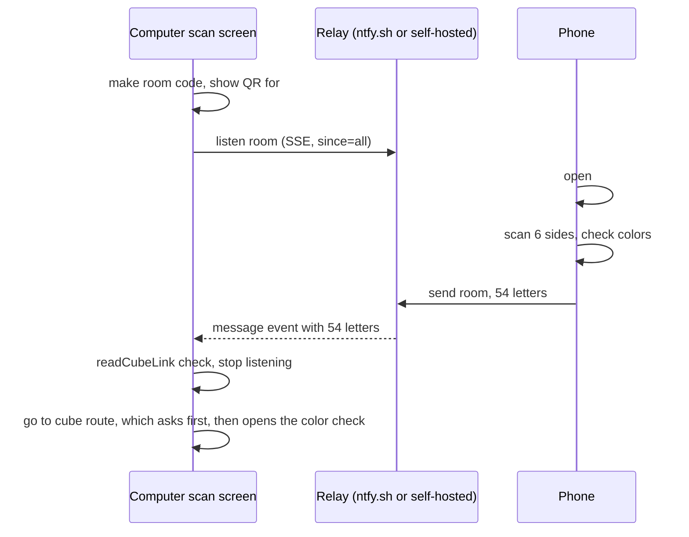

# Phone as Camera, Computer as Screen, and an Exit Button - Plan

## Goal Capsule

- **Objective:** A child scans the cube with a phone and the cube opens by itself on the computer's color check, ready for Solve or Learn on the big screen, and on any screen of work the child can leave with one Exit button after a truthful warning.
- **Means:** a small swappable relay that carries the 54-letter cube from phone to computer (KTD1, KTD2), and an Exit button that reuses the existing confirm dialog (KTD6).
- **Authority:** Product Contract requirements (R) win on behavior. Key Technical Decisions (KTD) win on mechanism within those requirements. Units override neither.
- **Execution profile:** one PR. `ce-work` builds the units in order. The owner tries the phone-to-computer flow on a real phone and computer before merge (see Open Questions).
- **Stop conditions:**
  - Stop and ask if ntfy.sh no longer allows browser requests from any origin, or adds a sign-up for publishing.
  - Stop and ask if the Exit button cannot fit in any top bar at 360 px wide without hiding or cutting off another button's word.

---

## Product Contract

### Summary

On the computer, "Scan with your phone" shows a QR code that holds a random room code, and the window waits for the phone. The phone scans and checks the colors, then "Send to computer" sends the cube through a free relay to that room. The computer gets the cube, runs the usual cube-link checks, and opens the color check on the big screen. The old link stays as a backup. Every screen of work gets an Exit button that goes Home after a warning that says what is really lost.

### Problem Frame

Today the phone link goes one way only. The computer opens the scan on the phone, and then the computer does nothing. The child must move the cube back by hand, through the share sheet or a copied link. To the owner this felt like the whole app moved to the phone, and the big screen was lost for Solve and Learn.

The earlier plan (`docs/plans/2026-11-24-1912-feat-scan-check-and-phone-link-plan.md`) chose "no server" on purpose and said to revisit it if children cannot get the link to the computer. Real use has now shown that, so this plan revisits it.

Separately, after a scan starts there is no clear way to stop and leave. Each screen has only Back, and Back goes one step, not Home.

### Key Decisions

- **The phone sends the cube to the computer through a free outside relay.** (session-settled: user-approved — chosen over the link-only, no-server design: the computer must get the cube by itself.) Governs R1, R2, R3, R4.
- **The relay is swappable, and it can be self-hosted.** (session-settled: user-directed — chosen over a fixed ntfy.sh: the owner asked that other free or self-hostable relays can be used.) Governs R6.
- **Exit shows on every screen of work and always asks first.** (session-settled: user-directed — chosen over Exit on the scan screen only: the owner asked for it "in general, not just for the scanning".) Governs R8, R9.

### Requirements

**Phone to computer**

- R1. On the computer, "Scan with your phone" shows a QR code and the link as text. Both open the phone's scan with a new random room code. The window says it is waiting for the phone.
- R2. On the phone, once the colors make a real cube, "Send to computer" sends the cube to the computer that showed the QR code. The phone then says "Sent! Look at your computer."
- R3. When the computer gets a cube, it closes the window and opens the cube as a cube link does today: full checks first, a question before replacing saved work, then the color check.
- R4. A message that is not a usable cube changes nothing on the computer, and the computer keeps waiting.
- R5. If the send fails, or the phone was not opened from a QR code, the phone shows the cube link as text and offers share or copy, as it does today.
- R6. The relay address is set at build time. One small part of the code talks to the relay, so another relay can replace it without changes elsewhere.
- R7. Only the 54 cube letters go to the relay. Nothing else is sent: no saved progress, no settings, no pictures.

**Exit**

- R8. Scan, one-side scan, color check, Solve, Learn, and Practice each have an Exit button in the top bar. It has a visible word and goes Home after the child agrees.
- R9. The warning tells the truth. Where work is lost (a picture on the check panel before Next, or Practice moves), it names that loss. Elsewhere it says the cube is saved and the child can keep going from Home.
- R10. "Stay" is the first and main button of the warning. Esc keeps the child on the screen.

### Acceptance Examples

- AE1. Covers R3. **Given** the computer has saved work for a different cube, **when** the cube arrives from the phone, **then** the computer asks "Open the cube from this link? Your saved cube will be deleted." and changes nothing until the child answers.
- AE2. Covers R4. **Given** the window is waiting, **when** the relay delivers text that is not 54 cube letters with centers in place, **then** nothing changes and the window keeps waiting.
- AE3. Covers R5. **Given** the phone opened the app from Home, not from a QR code, **when** the child taps "Send to computer", **then** the share sheet or copy runs, as today.
- AE4. Covers R9. **Given** Practice has 3 moves made, **when** the child taps Exit, **then** the warning says the practice cube will be lost.
- AE5. Covers R9. **Given** Solve is on move 5, **when** the child taps Exit, **then** the warning says the cube is saved and Home has "Keep going".

### Scope Boundaries

- No live view of the phone camera on the computer.
- No reply from the computer to the phone. "Sent!" means the relay got the cube, not that the computer opened it.
- No accounts and no saved rooms. A refreshed or closed window needs a new QR code.
- Non-goal, considered and not built: encrypting the cube before it goes to the relay. The 54 letters hold no personal data, and the room code is random. Revisit if anything personal is ever added to the message.
- Non-goal, considered and not built: a warning on the browser's Back button or the phone's back gesture. The router cannot stop a hash change, and every step except the two in R9 is already saved. Revisit if children lose Practice moves this way in real use.

### Deferred to Follow-Up Work

- A second relay adapter for piping-server (`ppng.io`, or self-hosted with one Docker command). The swappable part in R6 makes it about 15 lines. Add it only if ntfy.sh fails in real use.

---

## Planning Contract

### Key Technical Decisions

- KTD1. **ntfy.sh is the default relay, and it is used with plain `fetch` and `EventSource`.** The phone publishes with a POST to `<base>/<room>`. The computer listens on `<base>/<room>/sse?since=all` and reads the `message` events. It is free, needs no account and no new dependency, and its browser access from any origin was checked on 2026-11-25. Self-hosting ntfy needs only the base address changed (KTD2). Rejected: WebRTC (PeerJS, Trystero), because it can fail on mobile networks without a TURN server and is heavy for 54 bytes. Rejected: public MQTT brokers, because they need a ~100 KB library. Rejected: Firebase and Supabase, because they need an account and keys.
- KTD2. **The relay lives behind one small module with two calls.** `send(room, text)` returns a promise. `listen(room, onText)` returns a stop function. It is the only file that knows the relay. Its base address comes from `VITE_RELAY_URL` and falls back to `https://ntfy.sh`. Swapping to another relay type means a new version of this one file (R6).
- KTD3. **The room code is 128 random bits from `crypto.getRandomValues`, as about 26 lowercase letters and digits, with a `cube-` prefix.** Anyone who knows a ntfy topic can read it, so the code must not be guessable. It never contains `/`, because the router splits the address on `/`. It can never equal a one-letter side color, so the scan never mistakes it for a one-side retake. The phone accepts a room only when it matches this exact shape (`cube-` plus at least 26 lowercase letters or digits). The address is outside input, and a crafted link could otherwise add `?` and relay options such as email forwarding to the publish address (R7).
- KTD4. **The room rides in the QR link as `#/scan/<room>`, then in `sessionStorage`.** The scan screen stores a valid room param (KTD3) when it opens. The color check reads it at send time. A room carries one send, because the computer stops listening after the first cube. So the room is removed after each send, whether it worked or not, and when a full scan opens with no param (a fresh start from Home or "Scan again"). A one-side retake keeps it. It cannot go in the saved session: `startNewWork` resets every field at the first Next, and changing the session `VERSION` deletes everyone's saved work. `sessionStorage` belongs to that one tab, so it survives a refresh and the scan-to-check step, and it ends when the tab closes. Every read and write is in try/catch, as in `src/app/storage.ts`.
- KTD5. **The relay keeps its normal 12-hour cache, and the computer listens with `since=all`.** The room is new for each window, so a replay can hold only this child's cube. The cache means a short drop in the computer's connection does not lose the cube. This was chosen over the `Cache: no` header, which would drop a cube sent while the listener was reconnecting. The cost is that ntfy.sh keeps 54 cube letters under an unguessable name for 12 hours (R7).
- KTD6. **Exit reuses `confirmDelete` from `src/ui/confirm.ts` and goes Home with `go('home')`.** The dialog already puts the "keep" button first and treats Esc and a screen change as "keep" (R10). Each screen gives its own words from what it really loses (R9). A new `exit` icon (an X) goes in `ICONS` in `src/ui/dom.ts`. The function is not renamed. It has 4 callers, and the name does not change behavior.
- KTD7. **The computer's listener stops in two places: when the window closes, and in the scan screen's cleanup.** Leaving the screen removes the open dialog without firing its close event (`router.ts` uses `replaceChildren`), so the cleanup must also stop it.

### High-Level Technical Design

### Assumptions

- The phone and the computer can run different app versions for a while, because an update waits until every app window has closed. An old phone has no relay send, and an old computer has no listener. The link in R5 covers both cases.
- The phone and the computer are both online. Offline, the send fails and R5 applies.

---

## Implementation Units

### U1. Relay module

- **Goal:** one file that can send a short text to a room and listen to a room (KTD1, KTD2, KTD3).
- **Requirements:** R6, R7
- **Dependencies:** none
- **Files:** `src/app/relay.ts` (new), `src/types.d.ts` (type for `VITE_RELAY_URL`), `tests/app/relay.test.ts` (new)
- **Approach:**
  1. Export a room-code maker per KTD3, plus `send` and `listen` per KTD2.
  2. `send` POSTs the text and rejects on a network error, a non-OK status, or after 8 seconds with no answer.
  3. `listen` opens an `EventSource` per KTD5, passes each `message` event's `message` field to the callback, ignores other events and bad JSON, and returns a stop function that closes the source.
- **Patterns to follow:** the try/catch and quiet-failure style of `src/app/storage.ts` and `src/ui/wake-lock.ts`.
- **Test scenarios:** (the seam is the module with `fetch` and `EventSource` stubbed. It catches the request shape and event parsing. It misses the real relay, which the owner's device check covers.)
  - `send('cube-abc', 'UUU…')` POSTs to `https://ntfy.sh/cube-abc` with the text as the body.
  - With `VITE_RELAY_URL` set to another address, `send` and `listen` use that address.
  - `send` rejects when `fetch` rejects, when the status is 500, and when the request hangs past 8 seconds.
  - `listen` opens `<base>/<room>/sse?since=all`, and a `message` event with JSON `{"event":"message","message":"X"}` calls back with `X`.
  - `open` and `keepalive` events, and data that is not JSON, do not call back.
  - The stop function closes the `EventSource`, and later events do not call back.
  - Two room codes are different, are at least 26 characters after the prefix, have no `/`, and match no side color letter.
- **Verification:** the tests pass, and no other file in `src/` uses `fetch` or `EventSource`.

### U2. Computer waits for the phone

- **Goal:** the QR window on the computer listens for the cube and opens it when it arrives.
- **Requirements:** R1, R3, R4
- **Dependencies:** U1
- **Files:** `src/scan/scan-screen.ts`, `tests/scan/scan-screen.test.ts`
- **Approach:**
  1. In `openPhone()`, make a room code and build the link as `${location.origin}${location.pathname}#/scan/<room>` (KTD4). Add a waiting line with `role="status"`, such as "Waiting for your phone…".
  2. Start `listen`. On each text, run `readCubeLink`. Ignore anything it rejects (R4). On a usable cube, stop listening, close the window, and `go('cube', cube)`, so `cubeLinkScreen` does the checks, the question, and the move to the color check (R3).
  3. Stop the listener in the dialog's `onclose` and in the scan screen's cleanup (KTD7).
- **Patterns to follow:** the existing `openPhone()` dialog, and the `vi.hoisted` + `vi.mock` module mocks in `tests/scan/scan-screen.test.ts`. Mock `src/app/relay.ts` the same way.
- **Test scenarios:**
  - Opening the window shows a link that ends in `#/scan/cube-` plus the room code, and a QR with the same link.
  - The window shows the waiting line.
  - The mocked relay delivers a valid 54-letter cube, and the address becomes the cube route, then the color check.
  - Covers AE2. The relay delivers `hello`, then a cube with a moved center. The window stays open, the address does not change, and the listener is still running.
  - Closing the window with Close or Esc calls the stop function, and focus goes back to "Scan with your phone".
  - Leaving the scan screen with the window open calls the stop function.
  - Covers AE1. With saved work for another cube, a delivered cube shows the replace question, and "Keep my cube" leaves the saved work unchanged. (This can live in `tests/app/cube-link.test.ts` if driving it from the scan test is awkward.)
- **Verification:** the scan screen tests pass, including the updated link-text checks.

### U3. Phone sends to the computer

- **Goal:** a phone opened from the QR code sends the checked cube to the waiting computer.
- **Requirements:** R2, R5, R7
- **Dependencies:** U1
- **Files:** `src/scan/scan-screen.ts`, `src/review/net-editor.ts`, `tests/scan/scan-screen.test.ts`, `tests/review/net-editor.test.ts`
- **Approach:**
  1. When the scan screen opens, store or remove the room per KTD3 and KTD4.
  2. In `send()` in `net-editor.ts`, if a room is stored, show "Sending…" in the existing `role="status"` line and call `relay.send(room, facelets)`. Ignore taps while it runs.
  3. On success, remove the room (KTD4) and show "Sent! Look at your computer.".
  4. On failure, show the link and "Could not send. Tap Send to computer again to share the link.", and remove the room, so the next tap runs share or copy straight from that tap (R5). Share and copy need a fresh tap on phones, so they must not run after the awaited send.
  5. With no room stored, `send()` behaves exactly as today (AE3).
  6. Keep the button word "Send to computer" in every case.
- **Patterns to follow:** the current `send()` and its `copied` status line. The `vi.stubGlobal('navigator', …)` stubs in `tests/review/net-editor.test.ts`.
- **Test scenarios:**
  - Opening `#/scan/cube-` plus 26 valid characters stores the room.
  - Opening `#/scan/G` (a one-side retake) neither stores nor removes the room.
  - Opening `#/scan/x?email=a@b.c` stores no room, and a later send uses the link path.
  - Opening `#/scan` with no param removes a stored room.
  - With a room stored and the relay mocked to succeed, "Send to computer" sends exactly the 54 letters to that room and shows "Sent! Look at your computer.". Share and copy are not called.
  - After one successful send, a second tap does not call the relay and runs share (or copy) with the link shown.
  - A second tap while the send is still running does not send again.
  - With a room stored and the relay mocked to fail, the link and the "Could not send" words show, and share is not called. The next tap runs share (or copy).
  - Covers AE3. With no room stored, share (or copy) runs and the relay is not called.
  - A color change after a send hides the old status and link, as today.
  - When `sessionStorage` throws, the scan still opens and `send()` uses the link path.
- **Verification:** the scan and color-check tests pass.

### U4. Exit button on every screen of work

- **Goal:** the child can leave any screen of work for Home after a truthful warning.
- **Requirements:** R8, R9, R10
- **Dependencies:** none
- **Files:** `src/ui/dom.ts`, `src/scan/scan-screen.ts`, `src/review/net-editor.ts`, `src/solve/solve-screen.ts`, `src/learn/learn-screen.ts`, `src/practice/practice-screen.ts`, `src/styles.css`, `tests/scan/scan-screen.test.ts`, `tests/review/net-editor.test.ts`, `tests/solve/solve-screen.test.ts`, `tests/learn/learn-screen.test.ts`, `tests/practice/practice-screen.test.ts`, `tests/smoke.spec.ts`
- **Approach:**
  1. Add the `exit` icon per KTD6.
  2. Add an Exit `top-btn` at the right end of each top bar, with the icon and the word "Exit".
  3. On tap, call `confirmDelete` with words for that screen, and `go('home')` only on the drop answer (KTD6).
  4. Choose the words from what is really lost (R9):
     - Scan with a picture on the check panel: the picture just taken will be lost, and the other sides are saved.
     - Practice with at least one move: the practice cube will be lost.
     - Everywhere else, when `hasWorkToKeep()` is true (the same check Home uses to show "Keep going"): the cube is saved, and Home has "Keep going".
     - Otherwise: a plain "Go back Home?" that promises nothing.
  5. The keep button says "Stay", and the drop button says "Go Home" (R10).
- **Execution note:** check the top bars at 360 px wide first. Learn already has Back, Moves, and Scan again.
- **Patterns to follow:** existing top bars (`topbar`, `top-btn` with `icon()` and a visible word). The word sets `REPLACE_WORDS` in `src/app/cube-link.ts` and `src/scan/scan-screen.ts`. The jsdom dialog stub in `tests/app/cube-link.test.ts`.
- **Test scenarios:**
  - Each of the six screens (full scan, one-side scan, color check, Solve, Learn, Practice) has a button named "Exit".
  - Tapping Exit opens a dialog whose first button is "Stay". Tapping "Stay" leaves the address and saved work unchanged.
  - Tapping "Go Home" goes to Home, and the saved work is unchanged. On Home, "Keep going" is offered where it was before.
  - Covers AE4. Practice with 3 moves shows words that say the practice cube will be lost.
  - Practice with 0 moves shows no loss words. With no saved work, it shows the plain words.
  - Exit on a fresh scan with no saved work, and on a finished Solve, shows the plain words and does not mention "Keep going".
  - A scan with a picture on the check panel shows words that say that picture will be lost. Going Home does not save that picture.
  - Covers AE5. Solve on move 5 shows the "saved" words.
  - Esc on the warning keeps the child on the screen (e2e in `tests/smoke.spec.ts`).
  - On the scan screen, going Home through Exit stops the camera (the existing cleanup runs).
- **Verification:** unit and e2e tests pass. At 360 px wide no button word in any top bar is hidden or cut off, and Exit sits at the right end of the bar on every screen. The bar may wrap to two rows (`.topbar` already wraps).

### U5. Words in the README

- **Goal:** the README tells the truth about the relay and how to change it.
- **Requirements:** R6, R7
- **Dependencies:** U1
- **Files:** `README.md`
- **Approach:**
  1. Change "There is no server" and "is never sent anywhere": the app has no server of its own, and only "Scan with your phone" sends the 54 cube letters through a relay.
  2. Add a short "Use your own relay" section: set `VITE_RELAY_URL` to a self-hosted ntfy (one Docker command), or replace `src/app/relay.ts` for another relay type.
- **Test expectation:** none -- words only.
- **Verification:** the README states no "never sent" claim that the relay breaks.

---

## Verification Contract

| Gate | Command | Applies to |
|---|---|---|
| Unit tests | `npm test` | U1 to U4 |
| Build, types, and service-worker check | `npm run build` | all units |
| End-to-end | `npm run e2e` | U4, and no break in the existing scan and cube-link specs |
| Real devices | the owner opens the deployed site on a computer, scans the QR with a phone, scans a cube, taps "Send to computer", and sees the cube open on the computer | U2, U3 |

The relay is mocked in every automated test. Only the real-device check proves the live relay.

---

## Definition of Done

- All requirements R1 to R10 are met, and every unit's test scenarios exist and pass.
- `npm test`, `npm run build`, and `npm run e2e` pass.
- The owner's real-device check succeeds once, on the deployed site.
- No code from abandoned attempts is left in the diff.

---

## Open Questions

- Merge gate: the owner runs the real-device check in the Verification Contract before merge. It does not block building the units.

## Deferred / Open Questions

These are review items left for the author. They do not block implementation.

### From 2026-11-25 review

- **The computer has no message when it cannot reach the relay** — U2, computer waits for the phone (P2, design-lens, confidence 75)

  If the computer is offline or the relay is blocked, the window says "Waiting for your phone…" forever. The child sends from the phone, sees "Sent!", and nothing happens on the computer, with no hint to use the link instead.

  Change: when the listener cannot connect, replace the waiting line with "Cannot reach the relay. Use the link below instead." and keep the link visible. Add a test for it.

## Sources

- ntfy publish, subscribe, and limits: https://docs.ntfy.sh/publish/, https://docs.ntfy.sh/subscribe/api/, https://docs.ntfy.sh/faq/ (browser access from any origin checked with curl on 2026-11-25).
- piping-server, for the deferred second adapter: https://github.com/nwtgck/piping-server
- Earlier no-server decision now revisited: `docs/plans/2026-11-24-1912-feat-scan-check-and-phone-link-plan.md` (Key Decisions and Alternatives).
- Code: `src/scan/scan-screen.ts` (`openPhone`, cleanup), `src/review/net-editor.ts` (`send`), `src/app/cube-link.ts` (`readCubeLink`, `cubeLinkScreen`), `src/app/session.ts` (`startNewWork`, `VERSION`), `src/ui/confirm.ts`, `src/ui/dom.ts` (`ICONS`), `src/app/router.ts` (`parse`, `render`).
